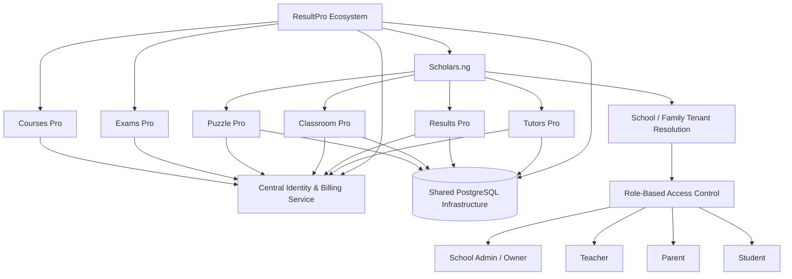
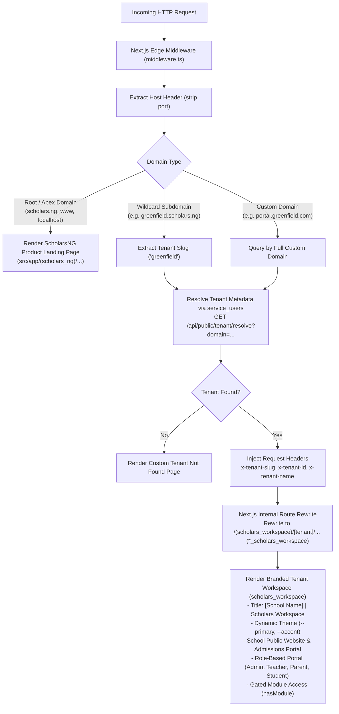

Sure. Let me word that cleanly for an agent. Here it is Instruction for mapping the result pro ecosystem applications and Scholars dot NG relationship for an agent to describe the relationships you've just outlined, covering the six products, their front doors, shared identity and billing, tenancy boundaries, and role based experiences for school admins, teachers, parents and students, across the Result Pro family, not one monolith. So, keep each front door, then define how identity, subscriptions, tenancy, and navigation connect. The goal is clean, modular, and safe, not merged into one thing. Don't change code yet, just map the architecture and the gaps first.

# Agent Instruction: ResultPro Ecosystem & Scholars.ng Application Relationship Mapping

**Objective:** Analyse and document the architectural, functional, tenancy, identity, billing, and user-experience relationships across the ResultPro family of applications.

The goal is to establish a clear architecture for how the applications operate independently while sharing infrastructure, identity, subscriptions, and selected user experiences through **Scholars.ng**.

This is an architecture-mapping exercise. Do not start rewriting applications, modifying databases, or changing existing implementations. First understand what exists, map the relationships, identify gaps, and produce an architectural recommendation.

---

## 1. Overview of the ResultPro Ecosystem

ResultPro is a family of education technology products designed to serve individual educators, students, parents, schools, and educational institutions.

The ecosystem consists of six applications:

| Application | Primary Function | Multi-Tenant |
|---|---|---|
| Tutors Pro | Tutor discovery, booking, teaching and assessment | Yes |
| Results Pro | School results processing and gradebook generation | Yes |
| Classroom Pro | Curriculum-aligned learning resources, tests and quizzes | Yes |
| Puzzle Pro | Interactive coding education for children | Yes |
| Courses Pro | Learning Management System (LMS) for independent educators | No school tenancy requirement |
| Exams Pro | National, international and professional examination preparation | No |

Each application must retain its own dedicated front door.

However, four applications will also be accessible through a shared educational platform called **Scholars.ng**.

---

## 2. Scholars.ng: The Unified Education Platform & Multi-Tenant Shell

Scholars.ng is the evolution of the existing School Hub concept.

It operates as a dual-purpose platform:
1. **ScholarsNG Product Landing & Commercial Gateway (The Apex Front Door)**: The dedicated public marketing page at `scholars.ng` that clearly presents the digital campus operating system, outlines product offers across the specialist sub-apps, and details transparent subscription tiers (Free, Starter, Pro, Enterprise).
2. **Multi-Tenant Shell Project & Tenant Workspaces**: A wildcard-enabled multi-tenant engine (`*.scholars.ng` and custom domains) that automatically routes each school to its own branded tenant workspace, deploying public admissions sites, administrative control centers, and role-based portals with modular entitlement gating.

Its primary purpose is to bring together:

1. Tutors Pro
2. Results Pro
3. Classroom Pro
4. Puzzle Pro

Scholars.ng is not intended to replace these applications.

Instead, it provides a unified environment through which users can access them.

### White-label architecture

Scholars.ng must support independent school environments via wildcard subdomains and custom domains.

For example:

- `laurelacademy.scholars.ng`
- `greenfield.scholars.ng`
- `brightfuture.scholars.ng`
- `portal.greenfieldacademy.com` (Custom Domain)

Each school receives its own environment, branding, configuration, subscriptions and authorised users.

The tenant's subscribed applications determine which modules become available within its Scholars.ng environment.

The same architecture should support family-based environments where appropriate.

### Important distinction

Scholars.ng is both:

- A commercial product with its own landing page and clear pricing.
- A multi-tenant shell project that resolves subdomains/custom domains into isolated tenant workspaces.
- A platform through which individual products can be discovered and accessed.

It must not become a requirement for every user to subscribe to the entire ecosystem.

---

## 3. Independent Application Front Doors

All six applications must remain independently accessible.

The following distinction is important.

### Applications integrated into Scholars.ng

**Tutors Pro**

An online tutoring marketplace and teaching platform.

It should support:
- Tutor registration and profiles.
- Tutor discovery and booking.
- Online and physical tutoring arrangements.
- Structured teaching sessions.
- Curriculum-aligned lesson delivery.
- Simulations and interactive exercises.
- Practice questions and assessments.
- Student performance tracking.
- Parent reporting.
- Tutor performance monitoring.

The objective is to make online tutoring sufficiently structured, measurable and accountable to compete with, and potentially outperform, conventional offline tutoring experiences.

**Results Pro**

A school results management application.

Its primary workflow involves uploading school marksheets containing student, class, subject and assessment information.

The application automatically processes the information and generates gradebooks and results reports.

Within Scholars.ng, school administrators and authorised teachers should access Results Pro according to their permissions.

**Classroom Pro**

A curriculum-aligned learning application.

It should provide:
- National curriculum-aligned content, particularly NERDC.
- Class notes.
- Learning materials.
- Quizzes and tests.
- Curriculum-based assessments.
- Learning resources for students and teachers.

Within Scholars.ng, schools should be able to provide these resources to their teachers and students.

**Puzzle Pro**

An interactive coding education platform for children.

It currently contains approximately 636 coding exercises using puzzles, monkeys and mazes to teach:

- HTML
- CSS
- Python
- JavaScript

It should be accessible independently and through Scholars.ng.

Schools and families should be able to provide children with access based on their subscriptions and permissions.

### Applications operating independently

**Courses Pro**

Courses Pro is an independent Learning Management System.

It is designed for educators who want to:

- Create and organise online courses.
- Manage students.
- Structure learning programmes.
- Accept payments.
- Deliver educational content.

Courses Pro is not primarily designed for school tenancy or institutional school management.

It should remain independently deployable and maintain its own product experience.

**Exams Pro**

Exams Pro provides preparation resources for national, international and professional examinations, including:

- WAEC
- NECO
- JAMB
- IJCEE
- IGCSE
- ICAN

Exams Pro is primarily an individual-user product.

Users register, select the examinations they are preparing for and access examination preparation resources.

Its monetisation model is based on purchasing coins when their existing balance runs out, rather than school or family subscriptions.

It does not require the school/family tenancy architecture used by the other four applications.

---

## 4. Central Identity and Billing Architecture

The ResultPro ecosystem already has a dedicated central microservice responsible for identity and billing.

This service must be treated as an existing foundational component.

Do not introduce another independent identity or billing system without a compelling architectural reason.

The central service is responsible for:

- User identity.
- Authentication.
- Account management.
- Billing.
- Subscription management.
- Product access entitlements.
- Cross-application account relationships.

### Unified identity

A user should maintain the same identity across the ResultPro ecosystem.

For example:

A teacher registers on Tutors Pro.

Later, the teacher decides to use Puzzle Pro to teach coding.

The teacher should not need to create another account.

The same identity should allow access to both applications.

Similarly, a school administrator using Scholars.ng should be able to access all subscribed modules without creating separate accounts for each application.

### Subscription relationships

The billing architecture should support:

- Individual product subscriptions.
- Multiple product subscriptions.
- School subscriptions.
- Family subscriptions.
- Bundled subscriptions.
- Discounts for users subscribing to multiple products.
- Product-specific entitlements.

Exams Pro must retain its coin-based purchase model.

Courses Pro must retain the flexibility required by independent educators and their course monetisation arrangements.

The agent must document how these existing and proposed billing arrangements interact with the central billing service.

---

## 5. Multi-Tenancy Architecture

The ResultPro ecosystem uses a shared PostgreSQL database architecture rather than requiring a separately deployed database for every school.

This is a deliberate architectural decision.

Unlike certain enterprise ERP deployments, the school applications do not currently justify the operational overhead of dedicated database deployments for every tenant.

### Tenant types

The architecture must accommodate:

1. Schools.
2. Families.

Every tenant-scoped record must be associated with the appropriate tenant.

For example:

- School ID.
- Family ID.
- User ID.
- Class ID.
- Student ID.
- Subscription ID.

The exact relationships should be determined from the existing database schema.

### Tenant-aware applications

The following applications must respect the tenancy model when accessed through Scholars.ng:

| Application | Tenant Scope |
|---|---|
| Tutors Pro | School / Family |
| Results Pro | School |
| Classroom Pro | School / Family |
| Puzzle Pro | School / Family |

The agent must investigate whether each application already implements these relationships and identify any missing tenant associations.

### Applications outside this tenancy model

**Exams Pro**

Does not require school/family tenancy.

Its core relationship is:

User → Examination Preparation → Coin Balance → Purchases.

**Courses Pro**

Operates as an independent LMS.

Its core relationship is:

Educator → Courses → Students → Enrolments → Payments.

Do not force either application into the Scholars.ng school/family tenancy model.

---

## 6. Role-Based Experience Within Scholars.ng

Scholars.ng must provide different experiences depending on the user's role.

The principal roles are:

### A. School Owner / Administrator

The administrator should have an overview of the entire institution.

This includes:

- School-wide performance.
- Student performance across classes.
- Teacher performance.
- Class performance.
- Application usage.
- Subscription information.
- Institutional analytics.

For users managing multiple schools, the architecture should support consolidated reporting across their authorised institutions.

### B. Teachers

Teachers should access tools relevant to their assigned classes and responsibilities.

Depending on their permissions and subscriptions, this includes:

- Classroom Pro learning resources.
- Results Pro assessment and grading tools.
- Tutors Pro teaching tools.
- Puzzle Pro coding exercises.

Teachers should be able to assess students, manage learning activities and monitor performance across their assigned classes.

### C. Parents

Parents should primarily have a reporting and monitoring experience.

They should be able to:

- View their children's academic performance.
- Receive assessment reports.
- Track learning progress.
- Receive notifications.
- Monitor tutoring activities.
- Access relevant learning information.

Parents should not automatically receive administrative or teacher-level permissions.

### D. Students

Students should have the most interactive learning experience.

Depending on the applications enabled for their school or family, they should be able to:

- Access learning materials.
- Complete quizzes and assessments.
- Participate in tutoring sessions.
- Practise coding.
- Access assignments.
- View their learning progress.

The agent should map the permissions and data access required by each role.

---

## 7. Navigation and Application Structure: Horizontal Subtab Architecture

Scholars.ng implements a shared, role-sensitive application shell modeled directly after the **`admin` modular apps architecture** (`admin/src/app/(dashboard)/`).

### 7.1 Single-Tab Lateral Feel with Horizontal Subtabs
To prevent the user interface from feeling fragmented or cluttered, the navigation collapses complex specialist applications into **single primary items on the left sidebar**, while internal workflows are organized as **horizontal subtabs across the top**:

- **Left Sidebar (Primary Navigation):**
  - **Dashboard / Pulse**: Institutional overview.
  - **ResultsPRO** (Single sidebar tab).
  - **ClassroomPRO** (Single sidebar tab).
  - **TutorsPRO** (Single sidebar tab).
  - **PuzzlePRO** (Single sidebar tab).
  - **Institutional Settings / Profile**.

- **Top Horizontal Subtabs (Secondary Workflow Navigation):**
  When a user selects an application on the left sidebar, the page renders a persistent horizontal tab bar across the top. The subtabs shown are **dynamically filtered according to the active user's role** (Admin, Teacher, Parent, Student), displaying only the views relevant to their responsibilities:

#### Role-Filtered Subtab Matrix:
| Application | School Admin / Owner Subtabs | Teacher Subtabs | Parent Subtabs | Student Subtabs |
| :--- | :--- | :--- | :--- | :--- |
| **ResultsPRO** | `Overview`, `Marksheet Upload`, `Gradebooks`, `Broadsheets`, `Scratch Cards`, `Report Cards Batch` | `My Classes`, `Marks Entry`, `Class Broadsheet`, `Psychomotor Domain` | `Child Term Report`, `Report Card PDF`, `Performance Trends` | `My Report Card`, `Subject Grades`, `Ranking Snapshot` |
| **ClassroomPRO** | `Curriculum Coverage`, `Handouts Registry`, `Teacher Compliance` | `Lesson Handouts`, `Quiz Manager`, `Student SRS Stats` | `Assigned Handouts`, `Homework Calendar`, `Study Streaks` | `Class Handouts`, `Practice Quizzes`, `Flashcards SRS Deck` |
| **TutorsPRO** | `Tutoring Network`, `Assigned Students`, `Session Logs` | `My Tutor Profile`, `Scheduled Sessions`, `Session Notes` | `Find Tutors`, `Upcoming Sessions`, `Payment History` | `My Tutors`, `Join Session`, `Lesson Library` |
| **PuzzlePRO** | `Class Coding Progress`, `Stage Leaderboards`, `Curriculum Waypoints` | `Class Progress`, `Waypoint Editor`, `Badge Awards` | `Child Progress`, `Coding Portfolio`, `Badges Earned` | `Play Adventure`, `Blockly Coding Canvas`, `My Badges & Stars` |

### Critical navigation rule

Only applications the tenant is subscribed to AND that the user is authorised to access should appear in their navigation.

The interface must respect:

- Tenant configuration.
- Product subscriptions (`tenant.enabled_modules`).
- User roles (Admin, Teacher, Parent, Student).
- Individual permissions.
- Application entitlements.

A school that subscribes to Results Pro and Classroom Pro should not see Tutors Pro and Puzzle Pro as active modules unless those applications are also enabled.

---

## 8. Architecture Relationship Diagram

Map the ecosystem using the following conceptual structure:



This is a conceptual relationship diagram, not confirmation of the current implementation. Verify actual database and service connections before documenting them as implemented.

---

## 9. What the Agent Must Investigate

Before recommending implementation changes, inspect the existing codebase and architecture.

Specifically:

**A. Application independence**
- Identify each application's frontend and backend.
- Identify its existing deployment configuration.
- Confirm that each application can operate through its own front door.
- Identify shared components and dependencies.

**B. Identity and billing**
- Locate the central identity and billing microservice.
- Map how each application authenticates users.
- Identify how product entitlements are checked.
- Document how subscriptions and coin purchases are handled.

**C. Tenancy**
- Inspect the PostgreSQL schema.
- Identify existing tenant tables and relationships.
- Verify tenant ID propagation.
- Check whether queries enforce tenant isolation.
- Identify any potential cross-tenant data leakage.
- Check whether family tenancy is already supported.

**D. Scholars.ng**
- Identify the existing School Hub implementation.
- Determine how it currently loads applications.
- Identify what is required to support independent school subdomains.
- Map tenant resolution from the hostname.
- Determine how tenant subscriptions control application availability.

**E. Permissions**
- Map the school owner, teacher, parent and student roles.
- Identify existing role-based access controls.
- Identify permissions that need to be introduced or refined.

---

## 10. Required Deliverables

Produce the following documents:

1. **Ecosystem Architecture Map:** A complete diagram showing the relationships between all six applications, Scholars.ng, identity, billing and database infrastructure.

2. **Application Relationship Matrix:** A table identifying which applications are standalone, which integrate with Scholars.ng, which are multi-tenant and their billing models.

3. **Identity and Billing Flow:** A diagram showing how one user identity works across multiple applications and how product entitlements are enforced.

4. **Tenant Architecture:** A diagram showing how schools and families are resolved, how tenant IDs propagate and how data isolation is maintained.

5. **Role and Permission Matrix:** A detailed breakdown of what school administrators, teachers, parents and students can access within each application.

6. **Navigation Architecture:** A proposed Scholars.ng interface structure showing the application sidebar, individual application navigation and role-specific dashboards.

7. **Existing Architecture Gap Analysis:** A comparison of the intended architecture against the actual implementation, identifying what already works, what is missing and what needs modification.

8. **Implementation Roadmap:** A prioritised sequence of changes required to achieve the intended architecture.

---

## 11. Important Architectural Constraints

The following principles must guide all recommendations:

1. Do not merge the six applications into one monolithic application.

2. Preserve independent front doors for all six products.

3. Scholars.ng should provide a unified experience for Tutors Pro, Results Pro, Classroom Pro and Puzzle Pro.

4. Maintain the existing central identity and billing microservice.

5. Do not introduce unnecessary identity duplication.

6. Maintain the shared PostgreSQL architecture for the school/family applications unless a demonstrable technical requirement justifies a change.

7. Enforce strict tenant isolation at the backend, not merely through frontend navigation.

8. Do not force Exams Pro into the school/family tenancy model.

9. Do not force Courses Pro into the Scholars.ng institutional architecture.

10. Support individual users who subscribe to multiple applications without requiring them to belong to a school.

11. Preserve existing application functionality and APIs wherever possible.

12. Do not implement architectural changes before completing the investigation and documenting the findings.

---

## 12. ScholarsNG Product Landing Page, Offers & Pricing Specification

ScholarsNG must feature a dedicated, high-converting product landing page deployed at the platform apex domain (`scholars.ng`, `www.scholars.ng`, or `localhost:3004` when no tenant subdomain is present). This page represents the commercial front door for the ScholarsNG product, communicating its value proposition, specialist app integrations, and transparent pricing.

### 12.1 Core Product Positioning
- **Hero Title**: The Operating System for Modern African & Global Schools.
- **Tagline**: Transform your institution into a mobile-first digital campus. Eliminate fragmented tools, lost receipts, and manual report processing by integrating results processing, curriculum learning, 1-on-1 tutoring, and future-skills coding into one branded environment.
- **Primary CTAs**:
  - `Deploy Your School Portal` (Launches multi-step onboarding wizard).
  - `Find Your School / Sign In` (School directory lookup / access code entry).
  - `Explore Live Demo` (Interactive sandbox).
  - `View Pricing & Plans`.

### 12.2 Product Offers & Integrated Specialist Apps
The landing page must clearly explain the four specialist products integrated into the ScholarsNG shell:

| Specialist Offer | Value Proposition for the School | Key Capabilities |
| :--- | :--- | :--- |
| **ResultsPRO Engine** | Flawless Continuous Assessment & Gradebook Automation | Instant marks upload, automated psychomotor evaluations, position-in-class rankings, broadsheets, tamper-proof scratch cards, and branded PDF report cards. |
| **ClassroomPRO LMS** | NERDC Curriculum-Aligned Offline-First Learning | Lesson notes, teacher handouts, formative quizzes, Spaced Repetition (SRS) study flashcards, zero-data offline home study sync. |
| **TutorsPRO Marketplace** | Structured 1-on-1 Academic Support | Vetted expert instructors, calendar booking, curriculum lesson delivery, parent progress monitoring, and targeted student remediation. |
| **PuzzlePRO Academy** | Gamified Coding & Computational Thinking | 636 interactive puzzle adventures teaching HTML, CSS, JavaScript, and Python with visual Blockly scaffolding and game mechanics. |

### 12.3 Role-Based Digital Campus Experience
The landing page must illustrate the distinct portals provided within each school's workspace:
- **School Owners & Administrators**: Institutional health KPI pulse, automated fee billing, staff payroll, admission funnel tracking, and teacher-class assignments.
- **Teachers**: Marksheet entry, attendance tracking, lesson handouts, formative quiz dispatch, and student subject performance charts.
- **Parents**: Real-time academic report cards, attendance alerts, tuition payment verification, teacher messaging, and child progress feeds.
- **Students**: Interactive lesson review, quiz tests, coding adventures, study streaks, and personal gradebook tracking.

### 12.4 Transparent Subscription Tiers & Pricing Model
The pricing section must directly reflect the centralized plan limits defined in `service_users` (`seed_plans.go`):

| Plan Tier | Price | Capacity | Included Features & Entitlements | CTA |
| :--- | :--- | :--- | :--- | :--- |
| **FREE** | ₦0 / forever | Up to 100 Students & 15 Teachers | ScholarsNG Mobile Apps, ResultsPRO (Basic Marks Entry & Cards), ExamsPRO (Free Practice CBT), 2GB Cloud Storage. | `Get Started Free` |
| **STARTER** | ₦15,000 / month | Up to 500 Students & 50 Teachers | ScholarsNG Mobile Apps, ResultsPRO (Full Gradebooks & PDF Reports), ExamsPRO (Standard CBT), ClassroomPRO LMS, 15GB Cloud Storage. | `Start with Starter` |
| **PRO** *(Popular)* | ₦35,000 / month | Up to 2,000 Students & 300 Teachers | ScholarsNG Mobile Apps, ResultsPRO & ExamsPRO, ClassroomPRO LMS, PuzzlePRO Coding Academy, 50GB Cloud Storage. | `Upgrade to Pro` |
| **ENTERPRISE** | ₦80,000 / month | Unlimited Students & Teachers | All Suite Products Enabled, Custom Domain Integration (`portal.yourschool.com`), Full White-Label Branding, Dedicated Account Manager, 500GB Cloud Storage. | `Contact Sales` |

---

## 13. ScholarsNG Multi-Tenant Shell Architecture: Wildcard Subdomains & Custom Domain Workspaces

ScholarsNG uses a **multi-tenant shell architecture** that dynamically routes requests based on the HTTP `Host` header. This enables zero-configuration wildcard subdomain integration (`*.scholars.ng`) and seamless custom domain onboarding (`portal.greenfieldacademy.com`).

### 13.1 Request Lifecycle & Routing Pipeline



### 13.2 Next.js Shell Middleware Specification
The shell middleware (`scholars_ng/web_app/src/middleware.ts`) must enforce:
1. **Definitive Host Resolution**: Always extract domain from `req.headers.get('host')`.
2. **Platform Domain Matching**: Read `process.env.NEXT_PUBLIC_PLATFORM_DOMAIN` (defaulting to `scholars.ng` or `localhost:3004`). If `hostname === platformDomain || hostname === 'www.' + platformDomain || hostname === 'localhost'`, serve the **Product Landing Page** (`src/app/(scholars_ng)`) without rewriting.
3. **Tenant Slug Extraction**:
   - For subdomains (`greenfield.scholars.ng` or `greenfield.localhost:3004`): slug is `hostname.split('.')[0]`.
   - For custom domains (`portal.greenfieldacademy.com`): slug is the full domain.
4. **Header Propagation**: Pass `x-tenant-slug` and `x-tenant-domain` to Server Components.
5. **Path Rewriting**: Rewrite `url.pathname === '/'` $\rightarrow$ `/${tenantSlug}` and `url.pathname === '/admin/pulse'` $\rightarrow$ `/${tenantSlug}/admin/pulse` (mapping internally to `(scholars_workspace)/[tenant]`).

### 13.3 Tenant Workspace Capabilities (`scholars_workspace`)
When a request is rewritten into the Tenant Workspace (`(scholars_workspace)/[tenant]`, wildcard identity `*_scholars_workspace`):
1. **Dynamic Theme & Brand Skinning**:
   - Injects tenant's `--primary`, `--secondary`, and `--accent` colors into CSS variables.
   - Sets document title to `${tenant.name} | Scholars Workspace`.
   - Loads tenant's `logo_url` and favicon dynamically in metadata.
2. **Public School Front Door**:
   - Displays the school's public website, history, admissions application form, school calendar, and contact information.
3. **Role-Based Single Sign-On Portals**:
   - `/[tenant]/admin`: Supervised control center for administrators.
   - `/[tenant]/teacher`: Classroom management and assessment gradebook.
   - `/[tenant]/parent`: Academic results, attendance alerts, and tuition payments.
   - `/[tenant]/student`: LMS handouts, formative tests, and coding games.
4. **Subscription Entitlement Enforcement (`hasModule`)**:
   - The shell verifies `tenant.enabled_modules` JSON array before rendering navigation links or pages.
   - If a tenant only subscribes to ResultsPRO and ClassroomPRO, TutorsPRO and PuzzlePRO tabs are automatically hidden from navigation and subroutes return 403 Forbidden.

### 13.4 Wildcard & Custom Domain Infrastructure
- **DNS Wildcard Record**: `*.scholars.ng` CNAME $\rightarrow$ `cname.vercel-dns.com` (or Cloudflare load balancer). This allows any newly registered school slug to resolve immediately without DNS intervention.
- **Custom Domain Provisioning**:
  - School creates CNAME `portal.myschool.edu.ng` $\rightarrow$ `cname.scholars.ng`.
  - Admin dashboard verifies domain mapping via `service_users` (`tenants.custom_domain`).
  - Automatic SSL certificates issued via Vercel / Let's Encrypt wildcard proxy.

---

## 14. Assessment of `scholars_ng/` Codebase & Implementation Roadmap

An inspection of the current `scholars_ng/` directory reveals the following current state and technical gaps:

### 14.1 Existing Strengths
- **Comprehensive Portal Views**: `scholars_ng/web_app/src/app/(portal)/` already contains rich dashboards for Admin (`admin/`), Teachers (`teacher/`), Parents (`parent/`), and Students (`student/`).
- **Tenant Context Structure**: `scholars_ng/web_app/src/components/TenantProvider.tsx` provides clean TypeScript types (`Tenant`) and a functional `hasModule` helper for feature gating.
- **Flutter Mobile App**: `scholars_ng/mobile_app/` contains a modular Flutter app with clean Clean Architecture feature folders (`admin`, `auth`, `onboarding`, `parent`, `profile`, `splash`, `student`, `teacher`).

### 14.2 Technical Gaps to Resolve
1. **Missing ScholarsNG Product Landing Page**: The current `scholars_ng/web_app/src/app/page.tsx` is an outdated demo for "My School Academy", not a commercial product page for ScholarsNG.
2. **Missing Edge Middleware**: `scholars_ng/web_app/src/proxy.ts` exists as an orphaned helper but is not configured as `middleware.ts` in the root of `web_app/`.
3. **Hardcoded Domain in Layout**: `layout.tsx` hardcodes `reedbreed.resultspro.ng` whenever `localhost` is encountered, which breaks local multi-tenant testing and prevents loading the product landing page on localhost.
4. **Missing Route Separation**: No clear separation between `(scholars_ng)` (for ScholarsNG marketing & pricing) and `(scholars_workspace)/[tenant]` (for tenant workspaces).

### 14.3 Implementation Roadmap
- [ ] **Phase 1: Shell Middleware**: Move and enhance `proxy.ts` to `scholars_ng/web_app/src/middleware.ts`. Support apex detection, wildcard subdomains, and custom domains.
- [ ] **Phase 2: Product Landing Page**: Build a modern, high-converting product landing page in `scholars_ng/web_app/src/app/(scholars_ng)/page.tsx` featuring the 4 specialist apps, role previews, and the 4 pricing tiers.
- [ ] **Phase 3: Tenant Workspace Restructuring**: Organize tenant workspaces under `/(scholars_workspace)/[tenant]` with dynamic branding resolution from `service_users` without hardcoded fallbacks.
- [ ] **Phase 4: Shared Feature Slices & Horizontal Subtabs**: Refactor specialist screens into shared presentational feature slices, configure monorepo transpilation, and implement horizontal subtabs matching the `admin` app layout.
- [ ] **Phase 5: Entitlement Hardening**: Connect `hasModule` checks to all sidebar navigation items and route guards across ResultsPRO, ClassroomPRO, TutorsPRO, and PuzzlePRO.

---

## 15. Single Codebase Monorepo Architecture: Standalone Apps & ScholarsNG Embedded Extension

### 15.1 Architectural Objectives & Core Dilemma
The platform faces a fundamental architectural requirement:
1. **Independent Front Doors**: Each specialist product (`ResultsPRO`, `ClassroomPRO`, `TutorsPRO`, `PuzzlePRO`) must exist as an independent, standalone web application accessible via its own brand domain (e.g. `resultspro.ng`, `classroompro.ng`, `tutorspro.ng`, `puzzlepro.ng`).
2. **Unified Institutional Workspace**: When a school tenant accesses their branded workspace on ScholarsNG (`<school>.scholars.ng` or custom domain `portal.school.com`), they need these specialist tools seamlessly integrated directly inside their school portal.
3. **The Duplication Trap**: Duplicating or copying screen code between standalone apps and `scholars_ng/web_app` creates massive technical debt, divergence of business logic, doubled testing burden, and inevitable synchronization bugs.

**Solution**: A **Single Codebase Monorepo Architecture** leveraging Next.js 16 transpilation, Presentational Feature Slices, and Host-Aware Adapters. Standalone apps and ScholarsNG consume the **exact same code components** with zero duplication.

---

### 15.2 Tenant Workspace Layout & Navigation: The `admin` Horizontal Subtabs Pattern
To maintain a clean, focused user experience, ScholarsNG does not overwhelm the left sidebar with dozens of nested links for each specialist tool. Instead, it adopts the **Modular Horizontal Subtabs** architecture proven in the `admin` app (`admin/src/app/(dashboard)/classroompro/page.tsx`):

1. **School Public Front Door (`/`)**:
   - For an unauthenticated visitor, `<school>.scholars.ng` displays the school's public website, admissions drive, curriculum overview, facilities showcase, announcements, and an "Apply for Admission" call-to-action.
2. **Protected Role Portals (Behind Login Wall)**:
   - Dedicated role-based portals: `/admin/*`, `/teacher/*`, `/parent/*`, `/student/*`.
   - Access is guarded by authentication and role verification. Unauthenticated requests redirect to `/login?redirect=...`.
3. **Smart Specialist Application Redirectors (`/resultspro`, `/classroompro`, etc.)**:
   - When a user accesses a root application link (e.g., clicking on ClassroomPRO or entering `/classroompro` on the tenant workspace), an auth-aware redirector automatically routes the user to their role-specific view:
     - School Owner / Admin $\rightarrow$ `/admin/classroompro`
     - Teacher $\rightarrow$ `/teacher/classroompro`
     - Parent $\rightarrow$ `/parent/classroompro`
     - Student $\rightarrow$ `/student/classroompro`
4. **Unified Single Sidebar Tab with Role-Filtered Horizontal Subtabs**:
   - In the left sidebar, each specialist app occupies a **single lateral entry** (e.g. `ClassroomPRO`).
   - Clicking it opens a unified workspace page featuring a horizontal subtab navigation bar at the top, rendering only the views relevant to the user's role:
     - **Admin Views**:
       - `ResultsPRO`: `Score Sheets` | `Grade Configuration` | `Scratch Cards / Access PINs` | `Report Card Batch Export`
       - `ClassroomPRO`: `Curriculum Management` | `Subject Oversight` | `Content Moderation` | `Analytics & Usage`
       - `TutorsPRO`: `Teacher Allocation` | `Lesson Schedules` | `Coverage Reports` | `Substitute Roster`
       - `PuzzlePRO`: `School Roster` | `Class Leaderboards` | `Curriculum Integration` | `Tournaments`
     - **Teacher Views**:
       - `ResultsPRO`: `Assessment Entry` | `Continuous Assessment (CA)` | `Remark Generator` | `Class Broadsheets`
       - `ClassroomPRO`: `Lesson Notes & Handouts` | `Interactive Quizzes` | `Flashcards Deck` | `Submissions & Grading`
       - `TutorsPRO`: `My Tutoring Schedule` | `Session Logs` | `Student Progress Notes` | `Assigned Mentees`
       - `PuzzlePRO`: `Class Assignments` | `Student Solves Tracker` | `Coding Challenge Creator`
     - **Parent Views**:
       - `ResultsPRO`: `Term Report Cards` | `Continuous Assessment Tracking` | `Scratch Card PIN Verification` | `Transcript PDF`
       - `ClassroomPRO`: `Enrolled Subjects` | `Weekly Study Material` | `Homework Tracker` | `Mastery Analytics`
       - `TutorsPRO`: `Request Curriculum Tutor` | `Active Sessions` | `Tutor Feedback` | `Session Billing`
       - `PuzzlePRO`: `Child Coding Progress` | `Badges & Streaks` | `Weekly Skill Growth Report`
     - **Student Views**:
       - `ResultsPRO`: `My Term Results` | `Performance Breakdown` | `PIN Scratch Pad`
       - `ClassroomPRO`: `Digital Handouts` | `Practice Quizzes` | `SRS Flashcards Deck` | `Study Streaks`
       - `TutorsPRO`: `Upcoming Sessions` | `Homework Help Room` | `Tutor Chat`
       - `PuzzlePRO`: `636 Coding Adventures` | `Daily Coding Quest` | `Battle Arena` | `My Skill Badges`

---

### 15.3 The Monorepo Presentational Feature Slice Pattern
To share these views between standalone applications and ScholarsNG without code duplication:

#### A. Component Architecture Separation
Each specialist application separates its codebase into two layers:
1. **Presentational Feature Slices (`src/features/*` or `src/components/modules/*`)**:
   - Pure UI and domain logic encapsulated into self-contained components (e.g. `NotesList`, `QuizRunner`, `FlashcardDeck`, `GradebookTable`, `PuzzleIDE`).
   - Components receive an `AppHostContext` or standard props:
     ```typescript
     export interface EmbeddedAppProps {
       tenantId?: string;
       user: { id: string; role: 'admin' | 'teacher' | 'parent' | 'student'; name: string };
       standalone: boolean; // false when embedded in ScholarsNG, true when accessed directly
       apiBaseUrl?: string;
       onNavigate?: (route: string) => void;
     }
     ```
   - When `standalone === true`, the feature renders standalone controls (e.g., public signup links, standalone pricing badges).
   - When `standalone === false`, the feature renders in institutional mode (scoped to `tenantId`, school branding, institutional grade scales).
2. **Host App Wrappers / Route Pages**:
   - In standalone apps (e.g. `classroompro/src/app/notes/page.tsx`): The route page mounts the feature slice with `standalone: true`.
   - In ScholarsNG (`scholars_ng/web_app/src/app/(portal)/teacher/classroompro/page.tsx`): The route page mounts the feature slice inside the horizontal subtab container with `standalone: false`.

#### B. Path Aliases & Next.js Module Transpilation
In `scholars_ng/web_app/tsconfig.json`:
```json
{
  "compilerOptions": {
    "paths": {
      "@/*": ["./src/*"],
      "@classroompro/*": ["../../classroompro/src/*"],
      "@resultspro/*": ["../../resultspro/src/*"],
      "@tutorspro/*": ["../../tutorspro/src/*"],
      "@puzzlepro/*": ["../../puzzlepro/src/*"]
    }
  }
}
```

In `scholars_ng/web_app/next.config.ts`:
```typescript
import type { NextConfig } from "next";

const nextConfig: NextConfig = {
  transpilePackages: [
    "@classroompro",
    "@resultspro",
    "@tutorspro",
    "@puzzlepro"
  ],
  // Enable modern React 19 / Next.js 16 monorepo resolution
  experimental: {
    externalDir: true, // Allows Next.js to import TypeScript source files from outside the app root
  }
};

export default nextConfig;
```

#### C. Unified Subtab Container Pattern (`SpecialistAppContainer.tsx`)
In `scholars_ng/web_app`, create a reusable container matching the `admin` layout:
```tsx
'use client';

import React, { useState } from 'react';
import { LucideIcon } from 'lucide-react';

export interface AppTab {
  id: string;
  label: string;
  icon: LucideIcon;
  component: React.ComponentType<any>;
}

interface SpecialistAppContainerProps {
  appTitle: string;
  appSubtitle: string;
  tabs: AppTab[];
  contextProps: any;
}

export function SpecialistAppContainer({
  appTitle,
  appSubtitle,
  tabs,
  contextProps,
}: SpecialistAppContainerProps) {
  const [activeTab, setActiveTab] = useState(tabs[0]?.id || '');
  const ActiveComponent = tabs.find(t => t.id === activeTab)?.component;

  return (
    <div className="w-full">
      {/* App Header */}
      <div className="border-b border-slate-200 bg-white px-6 py-4">
        <h1 className="text-xl font-bold text-slate-900">{appTitle}</h1>
        <p className="text-xs text-slate-500">{appSubtitle}</p>
      </div>

      {/* Horizontal Subtabs Bar (Admin Pattern) */}
      <div className="px-6 pt-4 bg-white border-b border-slate-200">
        <div className="flex space-x-2 overflow-x-auto pb-px scrollbar-hide">
          {tabs.map(tab => {
            const Icon = tab.icon;
            const isActive = activeTab === tab.id;
            return (
              <button
                key={tab.id}
                onClick={() => setActiveTab(tab.id)}
                className={`flex items-center space-x-2 px-4 py-3 border-b-2 font-medium text-xs transition-colors whitespace-nowrap ${
                  isActive
                    ? 'border-emerald-600 text-emerald-600 font-bold'
                    : 'border-transparent text-slate-500 hover:text-slate-800 hover:border-slate-300'
                }`}
              >
                <Icon className="w-4 h-4 stroke-2" />
                <span>{tab.label}</span>
              </button>
            );
          })}
        </div>
      </div>

      {/* Mounted Feature View */}
      <div className="p-6">
        {ActiveComponent ? <ActiveComponent {...contextProps} /> : null}
      </div>
    </div>
  );
}
```

---

### 15.4 Comparison: Duplication vs Monorepo Feature Slices

| Dimension | Code Duplication (Anti-Pattern) | Monorepo Feature Slices (Target Architecture) |
| :--- | :--- | :--- |
| **Code Duplication** | 100% duplicate screen files in `scholars_ng/` | **0% duplication**; single source of truth |
| **Bug Fix Lifecycle** | Must patch bug in standalone app AND copy to ScholarsNG | **Single patch** fixes standalone app and all school tenants instantly |
| **Feature Velocity** | Slower; features diverge and fall out of sync | **Instant parity**; new features in ClassroomPRO appear in ScholarsNG immediately |
| **Build & Bundle** | Bloated bundles; duplicate dependencies | Efficient; Next.js transpiles only imported feature slices with shared React 19 tree |
| **Brand Customization** | Hardcoded per copy | Controlled via `standalone: false` and CSS theme variables |

---

### 15.5 Required Codebase Modifications to Enable Direct Page Reuse (Universal Host Pattern)

To allow `@scholars_workspace` (`scholars_ng/web_app`) to mount **almost entire pages** directly from `@classroompro`, `@resultspro`, `@tutorspro`, and `@puzzlepro` without modifying business logic or breaking standalone operation, 5 focused modifications are required:

#### 1. Mod 1: Host Shell Separation (`standalone` Prop / Thin Route Wrappers)
- **The Issue**: Standalone pages currently embed outer layout chrome (e.g., `NoteDetailClient.tsx` renders `<Navbar />` and `<Footer />`; `NotesListPage` expects `DashboardLayout`). Mounting these directly in ScholarsNG would result in nested navbars and duplicate footers.
- **The Mod**: Adopt the **Thin Route Wrapper** pattern:
  - In each standalone app, extract the full-page inner content into a clean exported component (e.g. `NotesPageView.tsx`, `QuizPlayerView.tsx`, `ResultCheckerView.tsx`, `FindTutorView.tsx`, `PuzzleStudioView.tsx`).
  - The standalone route (`page.tsx`) renders: `<Navbar /><NotesPageView standalone={true} /><Footer />`.
  - When mounted inside ScholarsNG horizontal subtabs, it renders: `<NotesPageView standalone={false} />`.
  - When `standalone === false`, standalone navigation bars, standalone footers, and redundant "Back to Home" buttons are suppressed.

#### 2. Mod 2: Navigation & Route Translation (`HostNavigationProvider`)
- **The Issue**: Standalone pages contain hardcoded internal links (e.g. `<Link href="/dashboard/notes/123">`, `router.push('/dashboard')`, or `useNavigate()` in ResultsPRO).
- **The Mod**:
  - Provide a `HostNavigationProvider` and `useAppNavigate()` hook:
    - In standalone mode: Resolves native route paths (`/dashboard/notes/123`).
    - In ScholarsNG embedded mode: Automatically maps internal routes to ScholarsNG tenant workspace subtabs (e.g. `/[tenant]/student/classroompro?subtab=notes&id=123` or updates active subtab state).
  - In `resultspro`: Decouple `react-router-dom` from reusable views (provide a lightweight compatibility shim or standard React navigation props).

#### 3. Mod 3: Unified Auth & Tenant Context Bridge (`AppHostContext`)
- **The Issue**: Standalone apps query different `localStorage` keys for tokens (`accessToken`, `token`, `authToken`, `puzzlepro_student_user`) and different Zustand stores.
- **The Mod**:
  - Implement `<AppHostProvider>` in `scholars_ng/web_app` that supplies:
    ```typescript
    interface AppHostContextValue {
      tenant: { id: string; slug: string; name: string };
      user: { id: string; role: 'admin' | 'teacher' | 'parent' | 'student'; name: string };
      token: string;
      standalone: boolean;
    }
    ```
  - Update `useAuthStore` in each standalone app to check `AppHostContext` first. If present, it initializes the session from the host without requiring separate user logins.
  - On login in ScholarsNG, synchronize the session token across `localStorage` keys (`accessToken`, `token`, `authToken`) for backwards compatibility with legacy API interceptors.

#### 4. Mod 4: API Client Tenant Interceptor (`x-tenant-id` Injection)
- **The Issue**: Standalone Axios instances in `src/lib/api.ts` make requests without institutional tenant headers.
- **The Mod**:
  - Update the Axios request interceptors across all 4 apps:
    ```typescript
    api.interceptors.request.use((config) => {
      const token = getActiveToken();
      if (token) config.headers.Authorization = `Bearer ${token}`;
      
      const tenantId = getActiveTenantId();
      if (tenantId) config.headers['x-tenant-id'] = tenantId;
      
      return config;
    });
    ```
  - This ensures that when ClassroomPRO or ResultsPRO queries data, the backend automatically enforces school-level data isolation.

#### 5. Mod 5: Monorepo Package Transpilation & Exports (`transpilePackages`)
- **The Issue**: Next.js in `scholars_ng/web_app` will refuse to import TypeScript code from outside its project root unless transpilation is enabled.
- **The Mod**:
  - In `scholars_ng/web_app/next.config.ts`:
    ```typescript
    const nextConfig: NextConfig = {
      transpilePackages: ['@classroompro', '@resultspro', '@tutorspro', '@puzzlepro'],
      experimental: { externalDir: true }
    };
    ```
  - In `scholars_ng/web_app/tsconfig.json`:
    Configure path aliases mapping to each standalone app's `src/` directory.
  - In each standalone app, create a clean entry barrel (`src/modules.ts`) exporting its reusable full-page views.

---

### Final Instruction to the Agent

Think of ResultPro as an ecosystem of independent but interconnected educational products.

**Scholars.ng is the institutional and family-facing integration layer, not the owner of every application's functionality.**

Each application must retain its product identity, dedicated entry point and independent functionality.

The central identity and billing service provides continuity across the ecosystem, while tenant-aware applications enforce the appropriate school or family boundaries.

The ultimate objective is to build a modular educational technology infrastructure that can serve individual learners, tutors, families, individual educators and large school networks without forcing all of them into the same product experience.

**First deliver the architecture documentation and gap analysis. Do not modify the codebase until the proposed architecture has been reviewed and approved.**