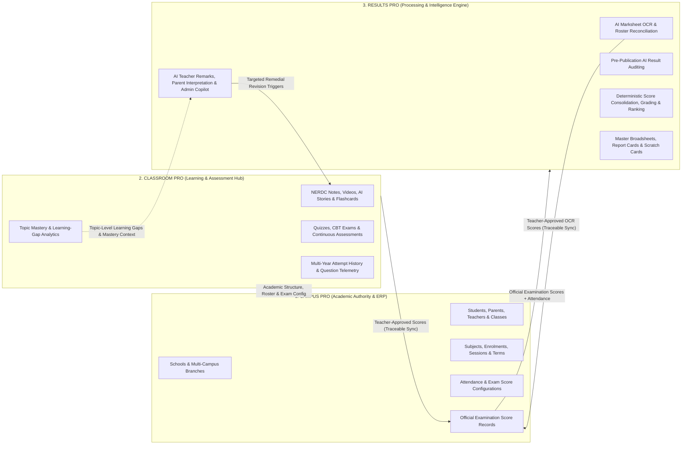
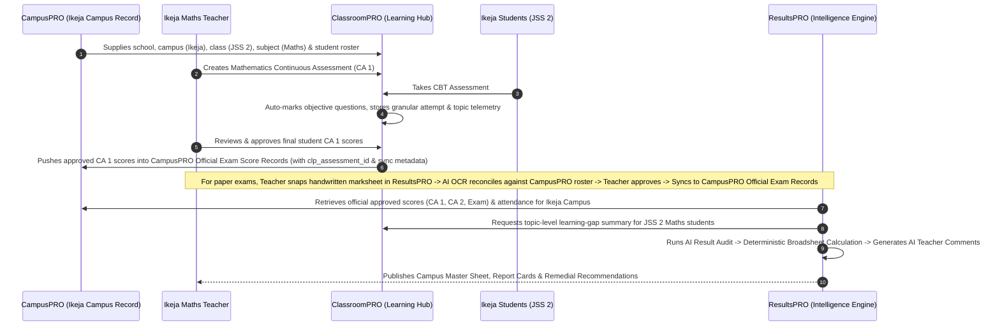
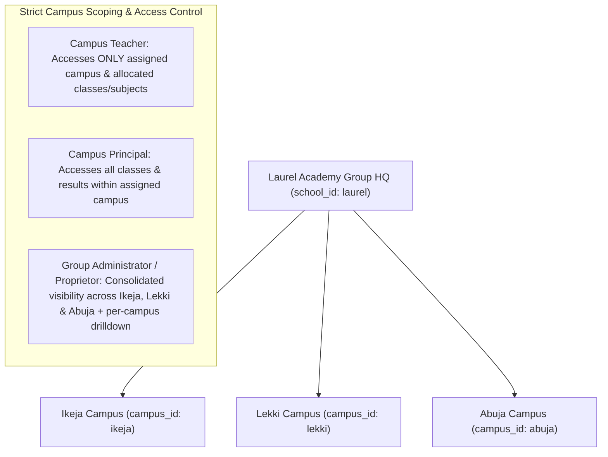
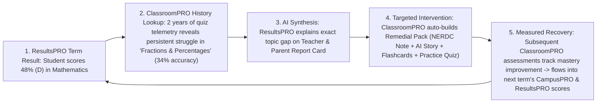

# The Connected Trio Architecture: CampusPRO · ClassroomPRO · ResultsPRO

> **Canonical Reference Document**  
> **Scope**: System-of-Record boundaries, multi-campus isolation, traceable score synchronization, and the AI-powered assessment & continuous academic improvement lifecycle across **CampusPRO**, **ClassroomPRO**, and **ResultsPRO**.

---

## 1. Executive Summary & Core Philosophy

Together, **CampusPRO**, **ClassroomPRO**, and **ResultsPRO** form an integrated **AI-Powered School Operating System, Learning Hub, and Assessment Intelligence Engine**.

To prevent duplicated responsibilities, conflicting records, or ambiguity about which application owns the academic truth, the ecosystem is governed by three strict architectural laws:

1. **Clear System-of-Record Boundaries**:
   - **CampusPRO is the Academic Authority & System of Record.** It defines the school's multi-campus structure, student identity, enrolments, attendance, examination configurations, and **approved official examination score records**.
   - **ClassroomPRO is the Central Learning, Assessment & Academic Activity Hub.** It captures and retains the student's multi-year learning and assessment journey (NERDC-aligned content, AI stories, flashcards, quizzes, continuous assessments, every student attempt, question-level telemetry, and learning-gap analytics) and **transfers teacher-approved scores into CampusPRO's official examination score records**.
   - **ResultsPRO is the Results Processing, Auditing & Performance Intelligence Engine.** It **retrieves approved official examination scores from CampusPRO** (never every raw quiz attempt), runs pre-publication AI audits, executes deterministic result arithmetic/grading/ranking, generates AI report-card narratives, distributes results, and synthesizes end-of-term performance intelligence enriched by ClassroomPRO's learning-gap telemetry.
2. **Foundational Multi-Campus Isolation**:
   - Multi-campus separation (`school_id` + `campus_id`) is a foundational requirement across all three products—never an afterthought. A school group (e.g., **Laurel Academy** with **Ikeja**, **Lekki**, and **Abuja** campuses) maintains strict campus-scoped records and permissions for teachers and students while giving group administrators both campus-specific and consolidated school-wide visibility.
3. **AI for Perception & Synthesis, Deterministic Software for Arithmetic**:
   - AI is used for document/handwriting interpretation (multi-sheet OCR), fuzzy student roster matching suggestions, anomaly detection, natural-language report-card comments, parent explanations, and remedial recommendations.
   - All score addition, weight scaling, grade assignment, class ranking, promotion rules, and broadsheet calculations remain **100% deterministic, reviewable, and auditable** in code. AI never silently resolves an uncertain student match or mutates a score without explicit human approval.

---

## 2. The Three-Product Architecture & System-of-Record Matrix

### Canonical Data Ownership Rules

| Data Domain | System of Record | Owning Microservice | Responsibility & Boundary |
| :--- | :--- | :--- | :--- |
| **Student identity & enrolment** | **CampusPRO** | `service_campuspro` | Canonical student profile, admission number, parent linkage, and active class/arm placement. |
| **Campus & class structure** | **CampusPRO** | `service_campuspro` | Multi-campus branches (`Ikeja`, `Lekki`, `Abuja`), classes, arms, subjects, and teacher allocations. |
| **Academic sessions, terms & attendance** | **CampusPRO** | `service_campuspro` | Active session/term calendar and daily/exam attendance logs. |
| **Examination configuration** | **CampusPRO** | `service_campuspro` | Assessment components (e.g., `CA1: 20`, `CA2: 20`, `Exam: 60`), maximum scores, and grading boundaries. |
| **Approved official examination scores** | **CampusPRO** | `service_campuspro` | The official approved scores per student, subject, term, and assessment component used for terminal results. |
| **Learning content & AI stories** | **ClassroomPRO** | `service_classroompro` | NERDC-aligned lesson notes, interactive AI stories, videos, and spaced-repetition flashcard decks. |
| **Assessment questions & CBT attempts** | **ClassroomPRO** | `service_classroompro` | Question bank, AI question generation, exam moderation, and live student quiz/CBT sessions. |
| **Detailed assessment history** | **ClassroomPRO** | `service_classroompro` | Every quiz attempted, every question answered, timestamps, multiple attempts, and engagement over years. |
| **Learning-gap analytics** | **ClassroomPRO** | `service_classroompro` | Granular topic-level mastery and struggle detection (e.g., *"Weak in Fractions & Word Problems with Percentages"*). |
| **Result calculations & report cards** | **ResultsPRO** | `service_resultspro` | Deterministic score consolidation, totals, averages, GPA, class/arm positions, master sheets, and PDF report cards. |
| **Scratch-card & portal result distribution** | **ResultsPRO** | `service_resultspro` | PIN batch generation, cryptographic verification, and parent/student result delivery. |
| **End-of-term academic intelligence** | **ResultsPRO** | `service_resultspro` | AI pre-publication auditing, AI report-card remarks, parent result interpretation, cohort analytics, and the AI Results Officer. |

---

## 3. End-to-End Multi-Campus Workflow: The "Laurel Academy" Reference Model

Consider **Laurel Academy**, a school group operating three campuses: **Ikeja**, **Lekki**, and **Abuja**.

### Step-by-Step Operational Lifecycle
1. **Structural Context from CampusPRO**: ClassroomPRO resolves the school (`Laurel Academy`), campus (`Ikeja Campus`), class (`JSS 2`), subject (`Mathematics`), and enrolled students directly from CampusPRO.
2. **Assessment Creation in ClassroomPRO**: The Ikeja Mathematics teacher creates a Continuous Assessment (`CA 1`) or CBT quiz in ClassroomPRO.
3. **Student Execution & Telemetry Capture**: Students take the assessment. ClassroomPRO automatically marks objective questions (and provides AI-assisted rubric suggestions for theory questions, subject to teacher approval).
4. **Teacher Review & Approval**: The teacher reviews the scores in ClassroomPRO and clicks **Approve & Synchronize to Official Exam Record**.
5. **Traceable Transfer to CampusPRO**: ClassroomPRO transfers only the approved scores into the corresponding examination score records (`CA 1`) in CampusPRO.
6. **Results Processing in ResultsPRO**: At the end of the term, ResultsPRO retrieves the official examination scores (`CA 1`, `CA 2`, `Exam`) from CampusPRO and processes the term's results.
7. **Retention of Granular History**: Even after term results are published, ClassroomPRO retains the full multi-year learning history—every quiz attempted, every question answered, topic accuracy, improvement across attempts, and engagement over time. ResultsPRO never duplicates this raw history.

---

## 4. Multi-Campus Isolation & Permission Model

Multi-campus separation is enforced at the database, API middleware, and UI layers:

- **Zero Cross-Campus Collision**: Every record in ClassroomPRO, CampusPRO, and ResultsPRO carries both `school_id` and `campus_id`. Even when two campuses have identical class names (`JSS 2 Gold`), identical subject names (`Mathematics`), or students with similar names, campus identity is preserved on every assessment, score, audit log, and broadsheet.
- **Role-Scoped Views**:
  - **Teacher**: Only sees the campus and classes assigned to them in CampusPRO's `campus_subject_allocations`.
  - **Campus Principal / Head Teacher**: Oversees result readiness, AI audits, and principal comments for their specific campus.
  - **School Group Administrator**: Can run result processing per campus or view consolidated cross-campus performance intelligence comparing Ikeja, Lekki, and Abuja.

---

## 5. Architectural Contract: Assessment History vs. Official Examination Score Records

A core requirement of this architecture is the formal separation—and traceable linkage—between **learning/assessment history** and **official examination records**:

### A. Assessment History in ClassroomPRO (`service_classroompro`)
- **Purpose**: Captures the complete formative and summative learning journey over multiple years.
- **Contents**:
  - Assessment definitions, NERDC curriculum topic mappings, and question metadata.
  - Individual student attempts (`attempt_number`, `started_at`, `completed_at`, `raw_score`).
  - Question-by-question responses (`question_id`, `selected_option`, `is_correct`, `topic_tag`, `difficulty`).
  - Longitudinal topic mastery index (`clp_student_topic_mastery`) tracking which concepts a student has mastered or struggles with over time.

### B. Official Examination Score Records in CampusPRO (`service_campuspro`)
- **Purpose**: The single authoritative ledger of approved scores attached to an official academic session, term, campus, class, subject, student, and examination component (`CA1`, `CA2`, `Exam`).
- **Traceability & Provenance Schema (`campus_official_exam_scores`)**:
  Every transferred score record retains:
  - `id` (UUID)
  - `school_id` & `campus_id` (Multi-campus isolation keys)
  - `session_id` & `term_id`
  - `class_id`, `arm_id`, `subject_id`, `student_id`
  - `component_code` (`CA1`, `CA2`, `PROJECT`, `EXAM`)
  - `score` & `max_obtainable`
  - `source_system` (`CLASSROOMPRO_CBT` | `RESULTSPRO_OCR_MARKSHEET` | `CAMPUSPRO_MANUAL`)
  - `source_reference_id` (Foreign reference to `clp_assessment_id` or `ocr_marksheet_batch_id`)
  - `approved_by_user_id` & `approved_at` (Teacher approval audit)
  - `sync_version` & `sync_status` (`SYNCED`, `SUPERSEDED`, `LOCKED`)
- **Safeguards**:
  - Prevents duplicate score entries via a unique composite key on `(school_id, campus_id, session_id, term_id, subject_id, student_id, component_code)`.
  - Prevents accidental overwrites by requiring explicit teacher re-approval and rejecting mutations once a term instance is locked/published.

---

## 6. The Continuous Academic Improvement Cycle

Because ClassroomPRO retains multi-year learning telemetry while ResultsPRO processes terminal examination results, the three products create a closed-loop academic improvement cycle:

1. **Macro Signal (ResultsPRO)**: Examination results show a student is underperforming in Mathematics.
2. **Micro Diagnosis (ClassroomPRO)**: ClassroomPRO's historical question-level telemetry reveals that the student actually excels in Geometry ($88\%$) but consistently struggles with **Fractions and Percentages** ($34\%$).
3. **Actionable Explanation (ResultsPRO)**: AI combines both signals so the teacher remark and parent interpretation pinpoint *why* the grade dropped and *what* to focus on.
4. **Targeted Remediation (ClassroomPRO)**: The parent or student clicks straight from the report card into ClassroomPRO to access recommended NERDC lesson notes, an **AI Story** that re-explains fractions using relatable everyday examples, spaced-repetition flashcards, and practice quizzes.
5. **Verified Improvement**: Subsequent assessments in ClassroomPRO measure whether the student has improved, and the next term's official scores in CampusPRO and ResultsPRO reflect that progress.

---

## 7. Six Major AI Pillars in ResultsPRO (+ The AI Results-Processing Officer)

With the Trio's boundaries established, ResultsPRO introduces AI across six high-impact areas plus an administrative copilot:

### Pillar 1: AI-Powered Result Entry (Handwritten Marksheet OCR & Multi-Sheet Reconciliation)
* **Priority**: 1 (High Priority — Flagship Webinar Demonstration)
* **Workflow**:
  1. Teacher selects **Campus, Class/Arm, Subject, Term, and Component** (from CampusPRO).
  2. Teacher uploads one or multiple photographs of handwritten marksheets (or uses **Voice-Assisted Score Entry**).
  3. **Handwriting & Multi-Sheet Recognition**: AI reads student names and scores across multiple pages and consolidates them.
  4. **Intelligent Roster Reconciliation**: AI fuzzy-matches handwritten names (even when abbreviated, misspelled, or reordered) against CampusPRO's campus-scoped student records.
  5. **Anomaly Flagging**: Flags missing scores, duplicate entries, and low-confidence readings.
  6. **Mandatory Teacher Approval**: AI *never* silently resolves uncertain matches or scores. The teacher reviews and approves flagged rows.
  7. **Official Sync**: Approved scores are committed to CampusPRO's official examination score records and processed by ResultsPRO.

### Pillar 2: AI Result Auditing & Pre-Publication Error Detection
* **Priority**: 2 (High Priority)
* **Capability**: Before results are published, the **"Run AI Result Audit"** button acts as an intelligent academic auditor across the class/campus:

| Detected Issue | AI Recommendation | Data Sources Checked |
| :--- | :--- | :--- |
| Student has no CA score | Missing assessment | CampusPRO Official Exam Scores |
| Total exceeds maximum score | Verify calculation | CampusPRO Exam Configuration |
| Duplicate student record | Check student identity | CampusPRO Student Roster |
| Unusually low / zero score | Flag for review | Statistical distribution of class |
| Student absent but has a score | Verify attendance | CampusPRO Attendance Logs vs. Exam Dates |
| Subject score missing | Request correction | CampusPRO Subject Enrolment |
| Score differs significantly from previous term ($>25\%$ delta) | Review performance | ResultsPRO Historical Term Records |
| Unusual grading pattern across teacher/subject | Moderation alert | Cross-subject / Cross-campus grade distribution |

* **Output**: An actionable audit summary (*"12 missing scores • 3 possible duplicate entries • 4 unusual score variations • 2 calculation inconsistencies"*) that teachers/admins resolve before approval.

### Pillar 3: AI-Generated Teacher Comments & Report-Card Narratives
* **Priority**: 3 (High Priority)
* **Capability**: Synthesizes current term scores, previous term trajectory, CampusPRO attendance, affective/psychomotor ratings, and ClassroomPRO topic strengths/weaknesses to draft personalized remarks:
  - **4 Role Generators**: Class Teacher's Remark, Subject Teacher's Remark, Head Teacher's Remark, Principal's Remark.
  - **4 Tone Presets**: *Encouraging*, *Corrective*, *Developmental*, and *Celebratory*.
  - **Human Control**: Teachers can batch-generate for an entire class, edit inline, and approve each remark.

### Pillar 4: AI-Generated Student & School Performance Intelligence
* **Priority**: 4
* **Student-Level Intelligence**: Subjects where the student excels, subjects requiring improvement, term-over-term comparison, ClassroomPRO concept gaps, learning consistency index, and clearly labeled **AI Result Forecasting**.
* **Class & Multi-Campus Intelligence**: Best/lowest-performing subjects, class averages, at-risk student radar, subjects requiring instructional attention, and the **AI Class Promotion Assistant** (evaluates students against configurable promotion criteria).
* **Conversational Data Queries**: Administrators can ask in plain English:
  - *"Which subjects experienced the biggest decline in SS2 at Ikeja Campus this term?"*
  - *"Identify students whose Mathematics performance has declined over the last three terms."*
  - ResultsPRO answers using actual school data and displays the verifiable underlying figures.

### Pillar 5: AI-Powered Result Interpretation for Parents
* **Priority**: 5
* **Capability**: Parents opening their child's result see a clear, plain-language executive summary alongside grades:
  - Subject-by-subject progress classification (*Excellent performance*, *Consistent performance*, *Significant improvement*, *Needs attention*).
  - Actionable home guidance (*"Your child improved in three subjects compared with last term. However, English Language remains an area requiring attention—specifically comprehension and summary writing. We recommend 20 minutes of daily reading practice."*).
  - Interactive Parent Q&A (*"Why did my child perform poorly in English?"*, *"Which subjects should we concentrate on during the holidays?"*, *"What can I do at home to support learning?"*).
  - **1-Click ClassroomPRO Bridge**: Launches recommended revision notes, AI stories, quizzes, and flashcards tailored to the child's exact performance gaps.

### Pillar 6: AI-Assisted Examination & Assessment Management (ClassroomPRO $\leftrightarrow$ ResultsPRO)
* **Priority**: 6
* **Capabilities**:
  - **A. AI Question Generation**: Teachers select Class, Subject, Topic, Difficulty, Count, and Format to generate NERDC-aligned questions in ClassroomPRO.
  - **B. AI Examination Moderation**: Checks for ambiguous phrasing, duplicate questions, incorrect answer keys, difficulty balance, and NERDC curriculum relevance.
  - **C. Automated & AI-Assisted Marking**: Objective questions are marked automatically; subjective responses receive AI-assisted marking suggestions with mandatory teacher approval.
  - **D. Item-Level Assessment Analytics**: Analyses questions students struggled with and flags topics requiring reteaching.

### Pillar 7 (The Long-Term Differentiator): The AI Results-Processing Officer
* **Capability**: An administrative copilot embedded in the ResultsPRO Admin Dashboard.
* **Workflow**: The administrator types or selects:
  > *"Prepare my school's end-of-term result processing for Primary 5 (Ikeja Campus)."*
* The AI Results-Processing Officer automatically:
  1. Checks CampusPRO subject allocations to verify whether all subjects have submitted/synced scores.
  2. Identifies outstanding teachers and offers one-click reminders.
  3. Validates the active grading scale and CA/Exam weight configuration.
  4. Runs the **AI Result Audit** across all submitted scores and surfaces anomalies.
  5. Verifies completion of Class Teacher and Principal report-card comments.
  6. Guides the administrator step-by-step through final approval, broadsheet generation, and parent distribution.

---

## 8. Phased Implementation Priority & Webinar Storyline

### Build Order
| Priority | Innovation | Architectural Flow | Core Value |
| :---: | :--- | :--- | :--- |
| **0** | **Multi-Campus Official Score Ledger & Sync API** | `ClassroomPRO` $\rightarrow$ `CampusPRO` $\rightarrow$ `ResultsPRO` | Enforces clean System-of-Record boundaries & campus isolation |
| **1** | **AI Marksheet Scanning & Score Extraction** | `ResultsPRO OCR` $\rightarrow$ `CampusPRO Roster & Ledger` | Immediate administrative time savings |
| **2** | **AI Result Auditing** | `CampusPRO Scores & Attendance` $\rightarrow$ `ResultsPRO Auditor` | Eliminates errors before publication |
| **3** | **AI Teacher Comments** | `CampusPRO + ClassroomPRO Gaps` $\rightarrow$ `ResultsPRO Narratives` | High-visibility practical value for teachers |
| **4** | **Student & Multi-Campus Performance Intelligence + AI Results Officer** | `CampusPRO + ResultsPRO + ClassroomPRO` | Makes results meaningful for leadership |
| **5** | **AI Parent Result Interpretation** | `ResultsPRO Report Card` + `Interactive Q&A` | Connects school assessment to the home |
| **6** | **ClassroomPRO Learning Recommendations** | `ResultsPRO Gap Card` $\rightarrow$ `ClassroomPRO Notes/Stories/Quizzes` | Completes the continuous improvement ecosystem |

### Flagship Webinar Demonstration Flow
**Title**: *"How AI Can Transform End-of-Term Results Processing in Nigerian Schools"*  
**Promise**: *"From manual score entry to intelligent academic reporting."*

1. **Multi-Campus Context**: Show Laurel Academy (Ikeja, Lekki, Abuja) where ClassroomPRO syncs approved CA scores into CampusPRO's official examination records.
2. **Snap Marksheet**: Teacher uploads a photographed handwritten exam marksheet for Ikeja Campus.
3. **AI Extraction & Roster Matching**: AI extracts handwritten scores and fuzzy-matches student names against CampusPRO's Ikeja roster.
4. **Audit & Human Approval**: AI flags missing scores, duplicates, or attendance conflicts; the teacher reviews and approves the entries.
5. **Master Broadsheet Generation**: ResultsPRO deterministically computes the master broadsheet, grades, and rankings.
6. **AI Report-Card Remarks**: AI generates personalized teacher and principal comments in one click.
7. **Executive Intelligence & AI Officer**: The school administrator views the multi-campus performance intelligence dashboard and uses the **AI Results-Processing Officer** copilot.
8. **Parent Delivery & ClassroomPRO Loop**: Parents open their child's result, read the AI plain-language interpretation, and launch targeted **ClassroomPRO** revision notes, AI stories, flashcards, and quizzes.

---

## 9. Enforced Screen Ownership & Zero-Duplication Map

To guarantee zero duplication across `CampusPRO` (`scholars_ng/web_app`), `ClassroomPRO` (`classroompro`), and `ResultsPRO` (`resultspro`), every screen and navigation item follows these strict boundaries:

| Domain / Screen Category | Canonical Owner | Canonical Routes | Prohibited in Other Apps |
| :--- | :--- | :--- | :--- |
| **School & Multi-Campus Setup, Sessions/Terms, Classes/Arms, Subject Definitions** | **CampusPRO** | `/admin/campus-os/academic` | Removed from `classroompro/src/app/dashboard/admin/{school,classes,terms}` and `resultspro/src/legacy-pages/onboarding` |
| **Manage Teachers & Subject Allocations** | **CampusPRO** | `/admin/campus-os/staff` (`StaffManager.tsx`) | Removed from `classroompro/src/app/dashboard/admin/teachers` |
| **Manage Students & Admissions** | **CampusPRO** | `/admin/campus-os/students` (`StudentManager.tsx`) & `/admin/campus-os/admission` | Removed from `classroompro/src/app/dashboard/{admin,teacher}/students` |
| **Manage Parents & Ward Linking** | **CampusPRO** | `/admin/campus-os/parents` (`ParentManager.tsx`) & `/parent/campus-os` | Removed from `classroompro/src/app/dashboard/parent/children` |
| **All Messaging, Circulars & Parent-Teacher Inbox** | **CampusPRO** | `/admin/campus-os/messaging` (`MessagingManager.tsx`), `/teacher/campus-os?subtab=messaging`, `/parent/campus-os?subtab=notices` | Removed from `classroompro/src/app/dashboard/{teacher,parent}/messages` and `resultspro/src/legacy-pages/{teacher,parent}/Messages.tsx` |
| **Attendance, Roll Call, Bursary/Fees, Timetable, Hostel, Library, Transport** | **CampusPRO** | `/admin/campus-os/{attendance,financials,timetable,hostel,library,transport}` & `/parent/campus-os?subtab=bursary` | Removed from `classroompro/src/app/dashboard/parent/billing` and redundant top-level routes in `scholars_ng/web_app` |
| **NERDC Lesson Notes, AI Storybooks, SRS Flashcards, Practice Quizzes & CBT Moderation** | **ClassroomPRO** | `classroompro/src/app/dashboard/*` & `scholars_ng/.../{admin/classrooms,teacher/classroom,parent/classroom,student/classroom}` | Never duplicated inside `CampusPRO` or `ResultsPRO` |
| **Multi-Year Attempt History, Topic-Gap Analytics & Traceable Official Score Push to CampusPRO** | **ClassroomPRO** | `/dashboard/teacher/analytics` (`TeacherAnalyticsView`) | Never duplicated inside `ResultsPRO` |
| **AI Marksheet OCR & Voice Entry, Pre-Publication Result Auditor, AI Report-Card Comments, Master Broadsheets, Multi-Campus Performance Intelligence & AI Results-Processing Officer** | **ResultsPRO** | `resultspro/src/app/dashboard` & `scholars_ng/.../{admin/results,teacher/results,parent/results,student/results}` | Moved out of `teacher/classroom/page.tsx` into dedicated `/teacher/results` |

