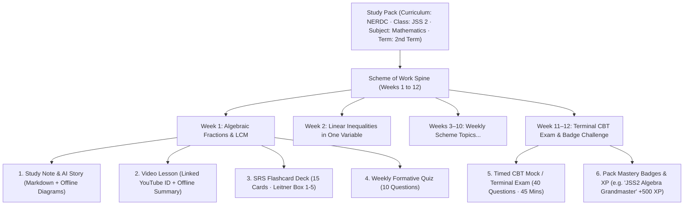
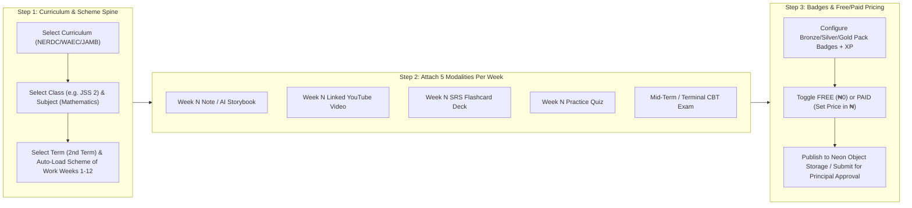

# ClassroomPRO Study Packs — Curriculum, Scheme-of-Work & Full-Modalities Architectural Plan

> **Audit Baseline (Codebase Reality vs. New Study Pack Architecture)**
>
> | Existing Component | File Location | How Study Packs Extend It |
> |---|---|---|
> | **NERDC Curriculum & Scheme of Work Hierarchy** (`cls_curriculum_topics`: `curriculum`, `education_level`, `class_code`, `subject_id`, `term`, `week`, `topic`, `subtopic`) | `service_classroompro/schema.sql`, `classroom-content/content-manifests/nerdc-manifest.json` | Every Study Pack is strictly anchored to **Curriculum + Class + Subject + Term + Scheme-of-Work Weeks (Week 1..13)**. Each week in a pack groups all 5 study modalities plus milestone badges. |
> | **All 5 Study Modalities + Gamification Badges** (`cls_notes`/`cls_lesson_versions`, `cls_flashcards`, `cls_video_lessons`, `cls_quizzes`, `GetExams`, `cls_gamification_profiles.badges`) | `service_classroompro/schema.sql`, `service_classroompro/handlers/handlers.go`, `trio_sync.go` | A single Study Pack bundles **1) Notes & AI Stories, 2) SRS Flashcards, 3) Linked YouTube Videos, 4) Topic Quizzes, and 5) Terminal/Mock CBT Exams**, and awards **Pack Mastery Badges & XP** into `cls_gamification_profiles`. |
> | **IndexedDB Offline Store** (`packages`, `lessons`, `assets`, `quizzes`, `flashcards`, `progress`, `bookmarks`, `sync_queue`) | `classroompro/src/lib/offlineDb.ts` | Add `videos`, `exams`, and `badges` stores to IndexedDB alongside `lessons`, `quizzes`, and `flashcards`. Extend `OfflinePackageRecord` with `scheme_of_work_weeks`, `exams`, `badges`, and `revoked` purge support. |
> | **Offline Sync Engine** (`fetchAvailableManifests`, `downloadPackage`, incremental version diffs, offline SVG/asset caching, idempotent `/sync/push`) | `classroompro/src/lib/syncEngine.ts` | Download all 5 modalities + badge rules in one bundle from **Neon Object Storage**; sync exam attempts & earned badges via `POST /api/sync/push`; auto-purge revoked/refunded packs on next online sync. |
> | **Teacher, Principal/Admin & Parent Dashboards** | `classroompro/src/app/dashboard/{teacher,admin,parent}/page.tsx`, `admin/src/app/(dashboard)/classroompro/page.tsx` | Add **Scheme-of-Work Study Pack Creator Studio** (with Free/Paid toggle & badge designer) on Teacher and Admin dashboards, and **Parent Ward Purchase & Badge Progress Hub** on the Parent dashboard. |

---

## 1. Locked Architectural Decisions

1. **Strictly Curriculum, Class, Subject & Scheme-of-Work Specific**:
   - Every Study Pack is bound to a specific **Curriculum** (`NERDC`, `WAEC`, `NECO`, `JAMB`, `BECE`, `BRITISH_NIGERIAN`), **Education Level & Class** (`Primary 1–6`, `JSS 1–3`, `SSS 1–3`), **Subject** (e.g., *Mathematics*, *Physics*, *English Language*), **Term** (`First Term`, `Second Term`, `Third Term`), and an explicit **Scheme of Work (`scheme_weeks_json`, e.g., Weeks 1–12 or selected weeks)**.
   - Inside a pack, content is organized week-by-week following the official scheme of work so a student, teacher, or parent sees Week 1 → Week 2 → … → Mid-Term CBT → Terminal Mock Exam.
2. **All 6 ClassroomPRO Study Materials & Gamification in Every Pack**:
   - **Study Notes & AI Illustrated Storybooks** (`NOTE` / `cls_lesson_versions` & `cls_notes` with portable `asset://cld-*` diagrams cached for 100% offline reading).
   - **Spaced-Repetition (SRS) Flashcard Decks** (`FLASHCARD_DECK` / `cls_flashcards` with SuperMemo-2 / Leitner box tracking in `cls_flashcard_progress`).
   - **Curated Educational Video Lessons** (`VIDEO` / `cls_video_lessons` using linked YouTube IDs, summaries, and offline-cached topic summaries).
   - **Formative Practice Quizzes** (`QUIZ` / `cls_quizzes` mapped to each Scheme-of-Work week/topic).
   - **Timed Mock & Terminal CBT Exams** (`EXAM` / `cls_pack_exams` for mid-term, terminal, WAEC/JAMB/BECE standard timed examinations with optional teacher score-approval sync to CampusPRO).
   - **Pack Completion & Mastery Badges** (`BADGE` / `cls_pack_badges` automatically awarded into `cls_gamification_profiles.badges` + bonus XP points when a student completes notes, flashcard streaks, weekly quizzes, and passes the pack's CBT exam).
3. **Creator-Controlled Free / Paid Pricing & Dual Creator Dashboards**:
   - Pack creators (Teachers and Admins) choose **`FREE` (₦0)** or **`PAID` (price in ₦ / kobo)**.
   - Full **Study Pack Creator Dashboard** on both the **ClassroomPRO Teacher Dashboard** (`/dashboard/teacher/study-packs`) and **ClassroomPRO Admin/Principal Dashboard** (`/dashboard/admin/study-packs` + Super-Admin `admin/src/app/(dashboard)/classroompro`).
4. **Parent Direct Purchase for Linked Children (Wards)**:
   - Parents browse packs filtered to each linked child's CampusPRO class & scheme of work, and buy (or claim free) directly for one or multiple linked children (`beneficiary_student_ids`).
5. **Neon Storage + Perpetual License + Refund Offline Purge**:
   - Metadata in **Neon Lakebase Postgres**; compiled versioned pack bundles in **Neon Object Storage** via presigned URLs.
   - Licenses are **perpetual** (`PERPETUAL`) for the beneficiary child.
   - Refunds or admin revocations flip `cls_pack_entitlements.status = 'REVOKED'` and trigger automatic `offlineDb.deletePackage(packId)` on the student's device upon next sync.

---

## 2. How Study Packs Are Organized (Curriculum → Scheme of Work → 5 Modalities + Badges)



### 2.1 Scheme-of-Work Unit Structure Inside a Pack
Every Study Pack contains an ordered array of **Scheme-of-Work Units** (`cls_study_pack_weeks`), where each unit represents a syllabus week (or exam milestone) and binds together:
1. **Lesson Note & AI Storybook** (`content_id` → `cls_lesson_versions` / `cls_notes`)
2. **Video Lesson** (`video_id` → `cls_video_lessons`)
3. **SRS Flashcard Deck** (`flashcard_ids[]` → `cls_flashcards`)
4. **Topic Practice Quiz** (`quiz_id` → `cls_quizzes`)
5. **Mid-Term / Terminal CBT Exam** (`exam_id` → `cls_pack_exams`)
6. **Milestone / Mastery Badge** (`badge_id` → `cls_pack_badges`)

### 2.2 Database Schema Extensions (`service_classroompro/schema.sql`)

```sql
-- 15. Study Packs Master Catalog (Curriculum, Class, Subject & Scheme-of-Work Scoped)
CREATE TABLE IF NOT EXISTS cls_study_packs (
    pack_id VARCHAR(191) PRIMARY KEY,
    slug VARCHAR(191) UNIQUE NOT NULL,
    tenant_id VARCHAR(64),                          -- NULL = platform pack; set = school-scoped pack
    creator_id VARCHAR(191) NOT NULL,               -- Teacher or Admin user_id
    creator_role VARCHAR(32) NOT NULL,              -- 'TEACHER' | 'SCHOOL_ADMIN' | 'PLATFORM_ADMIN'
    creator_name VARCHAR(191) NOT NULL,
    title VARCHAR(255) NOT NULL,
    subtitle VARCHAR(500),
    description TEXT,
    pack_scope VARCHAR(32) NOT NULL DEFAULT 'FULL_TERM_SCHEME', -- FULL_TERM_SCHEME | MULTI_WEEK_UNIT |SINGLE_WEEK_TOPIC | EXAM_PREP | REMEDIAL
    curriculum VARCHAR(64) NOT NULL DEFAULT 'NERDC',            -- NERDC | WAEC | NECO | JAMB | BECE
    education_level VARCHAR(64) NOT NULL,                       -- primary | junior-secondary | senior-secondary
    class_code VARCHAR(64) NOT NULL,                            -- primary-1..6 | jss-1..3 | sss-1..3
    class_label VARCHAR(128) NOT NULL,                          -- e.g. 'JSS 2'
    subject_id VARCHAR(64) NOT NULL,                            -- e.g. 'mathematics'
    subject_name VARCHAR(191) NOT NULL,                         -- e.g. 'Mathematics'
    term VARCHAR(64) NOT NULL,                                  -- 'first-term' | 'second-term' | 'third-term'
    term_label VARCHAR(128) NOT NULL,                           -- e.g. 'Second Term'
    scheme_start_week INT NOT NULL DEFAULT 1,                   -- e.g. Week 1
    scheme_end_week INT NOT NULL DEFAULT 12,                    -- e.g. Week 12
    scheme_overview_json TEXT NOT NULL,                         -- Ordered JSON of Scheme of Work weeks & topics covered
    pricing_type VARCHAR(16) NOT NULL DEFAULT 'FREE',           -- 'FREE' | 'PAID' (selected by pack creator)
    price_kobo BIGINT NOT NULL DEFAULT 0,                       -- 0 if FREE; e.g. 250000 (₦2,500) if PAID
    currency VARCHAR(8) NOT NULL DEFAULT 'NGN',
    visibility VARCHAR(32) NOT NULL DEFAULT 'PUBLIC',           -- PUBLIC | SCHOOL_ONLY | ASSIGNED_ONLY
    moderation_status VARCHAR(32) NOT NULL DEFAULT 'DRAFT',     -- DRAFT | PENDING_APPROVAL | PUBLISHED | ARCHIVED
    active_version INT NOT NULL DEFAULT 1,
    cover_asset_id VARCHAR(255),                                -- asset://cld-*
    preview_week INT DEFAULT 1,                                 -- Week unlocked as free sample preview
    total_xp_reward INT NOT NULL DEFAULT 500,                   -- Total gamification XP awarded on 100% completion
    created_at TIMESTAMP DEFAULT CURRENT_TIMESTAMP,
    updated_at TIMESTAMP DEFAULT CURRENT_TIMESTAMP
);

-- 16. CBT Mock & Scheme-of-Work Terminal Exams (Bundled Inside Study Packs)
CREATE TABLE IF NOT EXISTS cls_pack_exams (
    id VARCHAR(191) PRIMARY KEY,
    tenant_id VARCHAR(64),
    pack_id VARCHAR(191) REFERENCES cls_study_packs(pack_id) ON DELETE CASCADE,
    curriculum VARCHAR(64) NOT NULL DEFAULT 'NERDC',
    class_code VARCHAR(64) NOT NULL,
    subject_id VARCHAR(64) NOT NULL,
    term VARCHAR(64) NOT NULL,
    week_number INT NOT NULL DEFAULT 12,            -- e.g. Week 6 (Mid-Term) or Week 12 (Terminal Exam)
    exam_type VARCHAR(32) NOT NULL DEFAULT 'TERMINAL_MOCK', -- MID_TERM_CBT | TERMINAL_MOCK | WAEC_MOCK | JAMB_CBT
    title VARCHAR(255) NOT NULL,
    instructions TEXT,
    duration_min INT NOT NULL DEFAULT 45,
    pass_score_pct INT NOT NULL DEFAULT 60,
    questions_json TEXT NOT NULL,                   -- JSON array of CBT questions, options, correct_index, explanations, topic_tags
    sync_to_campuspro_component VARCHAR(32),        -- Optional: 'CA1' | 'CA2' | 'EXAM' when teacher approves official score sync
    created_by VARCHAR(191) NOT NULL,
    created_at TIMESTAMP DEFAULT CURRENT_TIMESTAMP
);

-- 17. Study Pack Badges & Achievement Rules (Integrated with cls_gamification_profiles)
CREATE TABLE IF NOT EXISTS cls_pack_badges (
    badge_id VARCHAR(191) PRIMARY KEY,
    pack_id VARCHAR(191) NOT NULL REFERENCES cls_study_packs(pack_id) ON DELETE CASCADE,
    code VARCHAR(128) UNIQUE NOT NULL,              -- e.g. 'BADGE_JSS2_MATH_T2_MASTER'
    name VARCHAR(191) NOT NULL,                     -- e.g. 'JSS 2 Term 2 Algebra & Inequalities Champion'
    description VARCHAR(500) NOT NULL,
    icon_svg_or_asset VARCHAR(255) NOT NULL,        -- Badge emblem identifier or inline SVG key
    tier VARCHAR(32) NOT NULL DEFAULT 'GOLD',       -- 'BRONZE' (Notes+Videos) | 'SILVER' (Flashcards+Quizzes) | 'GOLD' (Exam Distinction >=80%)
    xp_bonus INT NOT NULL DEFAULT 250,
    unlock_rule_json TEXT NOT NULL,                 -- e.g. {"min_notes_pct":100,"min_quiz_avg":70,"min_exam_score":75,"min_flashcards_mastered":10}
    created_at TIMESTAMP DEFAULT CURRENT_TIMESTAMP
);

-- 18. Student Earned Pack Badges Ledger
CREATE TABLE IF NOT EXISTS cls_student_pack_badges (
    id VARCHAR(191) PRIMARY KEY,
    student_id VARCHAR(191) NOT NULL,
    pack_id VARCHAR(191) NOT NULL,
    badge_id VARCHAR(191) NOT NULL REFERENCES cls_pack_badges(badge_id),
    xp_awarded INT NOT NULL DEFAULT 250,
    earned_offline BOOLEAN NOT NULL DEFAULT FALSE,
    awarded_at TIMESTAMP DEFAULT CURRENT_TIMESTAMP,
    UNIQUE (student_id, badge_id)
);

-- 19. Study Pack Scheme-of-Work Items (Maps Every Item to Week + Topic + Modality)
CREATE TABLE IF NOT EXISTS cls_study_pack_items (
    id VARCHAR(191) PRIMARY KEY,
    pack_id VARCHAR(191) NOT NULL REFERENCES cls_study_packs(pack_id) ON DELETE CASCADE,
    version INT NOT NULL DEFAULT 1,
    week_number INT NOT NULL,                       -- Scheme of Work Week (1..13)
    topic_id VARCHAR(191),                          -- Links to cls_curriculum_topics.id
    topic_title VARCHAR(255) NOT NULL,              -- Scheme of Work Topic Title
    position INT NOT NULL DEFAULT 0,
    item_type VARCHAR(32) NOT NULL,                 -- 'NOTE' | 'FLASHCARD_DECK' | 'VIDEO' | 'QUIZ' | 'EXAM' | 'BADGE'
    content_id VARCHAR(191) NOT NULL,               -- Foreign ID in cls_lesson_versions, cls_flashcards, cls_video_lessons, cls_quizzes, cls_pack_exams, cls_pack_badges
    content_version INT NOT NULL DEFAULT 1,
    required_for_badge BOOLEAN NOT NULL DEFAULT TRUE,
    is_free_preview BOOLEAN NOT NULL DEFAULT FALSE
);

-- 20. Immutable Study Pack Versions (Stored in Neon Object Storage)
CREATE TABLE IF NOT EXISTS cls_study_pack_versions (
    id VARCHAR(191) PRIMARY KEY,
    pack_id VARCHAR(191) NOT NULL REFERENCES cls_study_packs(pack_id) ON DELETE CASCADE,
    version INT NOT NULL,
    package_id VARCHAR(191) NOT NULL,               -- Links to cls_package_manifests.package_id
    neon_storage_key VARCHAR(512) NOT NULL,         -- packs/{tenant_or_global}/{pack_id}/v{version}/bundle.json
    size_bytes BIGINT NOT NULL DEFAULT 0,
    checksum_sha256 VARCHAR(128) NOT NULL,
    weeks_count INT NOT NULL DEFAULT 0,
    notes_count INT NOT NULL DEFAULT 0,
    flashcards_count INT NOT NULL DEFAULT 0,
    videos_count INT NOT NULL DEFAULT 0,
    quizzes_count INT NOT NULL DEFAULT 0,
    exams_count INT NOT NULL DEFAULT 0,
    badges_count INT NOT NULL DEFAULT 0,
    changelog TEXT,
    published_by VARCHAR(191),
    published_at TIMESTAMP DEFAULT CURRENT_TIMESTAMP,
    UNIQUE (pack_id, version)
);

-- 21. Parent & School Study Pack Orders (Paystack Integration)
CREATE TABLE IF NOT EXISTS cls_pack_orders (
    order_id VARCHAR(191) PRIMARY KEY,
    tenant_id VARCHAR(64),
    buyer_user_id VARCHAR(191) NOT NULL,            -- Parent user_id (or Student/School Admin)
    buyer_role VARCHAR(32) NOT NULL,                -- 'PARENT' | 'STUDENT' | 'SCHOOL_ADMIN'
    buyer_email VARCHAR(191) NOT NULL,
    pack_id VARCHAR(191) NOT NULL REFERENCES cls_study_packs(pack_id),
    beneficiary_student_ids_json TEXT NOT NULL,     -- JSON array of linked children e.g. ["stu-101","stu-102"]
    unit_price_kobo BIGINT NOT NULL,
    seats_count INT NOT NULL DEFAULT 1,
    total_amount_kobo BIGINT NOT NULL,
    currency VARCHAR(8) NOT NULL DEFAULT 'NGN',
    paystack_reference VARCHAR(191) UNIQUE NOT NULL,
    paystack_access_code VARCHAR(191),
    status VARCHAR(32) NOT NULL DEFAULT 'PENDING',  -- PENDING | PAID | FAILED | REFUNDED
    paid_at TIMESTAMP,
    refunded_at TIMESTAMP,
    refund_reason TEXT,
    created_at TIMESTAMP DEFAULT CURRENT_TIMESTAMP
);

-- 22. Perpetual Student Pack Entitlements (Supports Revocation & Offline Purge on Refund)
CREATE TABLE IF NOT EXISTS cls_pack_entitlements (
    entitlement_id VARCHAR(191) PRIMARY KEY,
    pack_id VARCHAR(191) NOT NULL REFERENCES cls_study_packs(pack_id),
    beneficiary_student_id VARCHAR(191) NOT NULL,
    purchased_by_user_id VARCHAR(191) NOT NULL,
    tenant_id VARCHAR(64),
    grant_source VARCHAR(32) NOT NULL,              -- 'PARENT_PURCHASE' | 'FREE_CLAIM' | 'TEACHER_ASSIGN' | 'REMEDIAL_LOOP' | 'SCHOOL_BULK'
    order_id VARCHAR(191) REFERENCES cls_pack_orders(order_id),
    license_type VARCHAR(32) NOT NULL DEFAULT 'PERPETUAL',
    status VARCHAR(32) NOT NULL DEFAULT 'ACTIVE',   -- 'ACTIVE' | 'REVOKED'
    granted_at TIMESTAMP DEFAULT CURRENT_TIMESTAMP,
    revoked_at TIMESTAMP,
    revoke_reason VARCHAR(255),
    UNIQUE (pack_id, beneficiary_student_id)
);

-- 23. Device Download & Offline Purge Registry
CREATE TABLE IF NOT EXISTS cls_pack_downloads (
    download_id VARCHAR(191) PRIMARY KEY,
    entitlement_id VARCHAR(191) NOT NULL REFERENCES cls_pack_entitlements(entitlement_id),
    pack_id VARCHAR(191) NOT NULL,
    pack_version INT NOT NULL,
    student_id VARCHAR(191) NOT NULL,
    device_fingerprint VARCHAR(191) NOT NULL,
    status VARCHAR(32) NOT NULL DEFAULT 'DOWNLOADED', -- 'DOWNLOADED' | 'PURGED_ON_REVOKE' | 'REMOVED_BY_USER'
    downloaded_at TIMESTAMP DEFAULT CURRENT_TIMESTAMP,
    purged_at TIMESTAMP
);
```

---

## 3. How Study Packs Are Managed (Scheme-of-Work Creator Studio on Teacher & Admin Dashboards)



### 3.1 Teacher Study Pack Creator Dashboard (`/dashboard/teacher/study-packs`)
Accessible from the Teacher Dashboard (`classroompro/src/app/dashboard/teacher/page.tsx`) and embedded ScholarsNG `/[tenant]/teacher/classroompro`:
1. **Curriculum & Scheme-of-Work Loader**:
   - Teacher selects **Curriculum** (`NERDC`), **Class** (auto-filtered to their CampusPRO assigned classes, e.g., *JSS 2 Gold*), **Subject** (*Mathematics*), and **Term** (*Second Term*).
   - Clicking **"Load Official NERDC Scheme of Work"** pre-populates Weeks 1–12 topics from `cls_curriculum_topics` (or allows the teacher to select a subset of weeks, e.g. Weeks 3–5 for a Topic/Remedial Pack).
2. **Week-by-Week Multi-Material Slot Matrix**:
   - Each week row has 4 slot pills + exam slot:
     - **[Note / AI Story]**: Pick existing lesson note or author a new portable Markdown note with `asset://cld-*` diagrams.
     - **[Video Lesson]**: Paste/select a curated YouTube Lesson ID (`cls_video_lessons`) with offline topic summary.
     - **[SRS Flashcards]**: Attach or AI-generate a 10–20 card Leitner deck (`cls_flashcards`) for that week's definitions/formulas.
     - **[Weekly Quiz]**: Attach a 10-question formative practice quiz (`cls_quizzes`).
   - **Exam Slot (Mid-Term / Final Week)**: Attach a timed **CBT Mock / Terminal Exam** (`cls_pack_exams`) covering all weeks in the pack.
3. **Pack Badges & Gamification Designer**:
   - Every pack automatically generates 3 tier badges (which the creator can customize):
     - **Bronze Badge (`Explorer`)**: Complete all Lesson Notes & Video summaries (+100 XP).
     - **Silver Badge (`Recall Pro`)**: Master ≥80% of the SRS Flashcard deck & pass all weekly quizzes (+200 XP).
     - **Gold Badge (`Scheme Grandmaster`)**: Score ≥75% on the Pack's Timed CBT Exam (+300 XP).
4. **Creator Free / Paid Toggle**:
   - Creator toggles **`FREE (₦0)`** or **`PAID (₦ Price)`** and selects which week (default Week 1) serves as the free sample preview for parents.

### 3.2 Admin / Principal Study Pack Creator & Moderation Console
Located at `classroompro/src/app/dashboard/admin/study-packs/page.tsx` and Super-Admin `admin/src/app/(dashboard)/classroompro/page.tsx` (**`Study Packs`** tab):
- **Scheme-of-Work Completeness Meter**: Shows a visual checklist verifying that every week in a submitted pack has its Note, Flashcards, Video, Quiz, CBT Exam, and Badge configured before approval.
- **Create & Moderate**: Admins can build official full-term scheme packs, approve teacher-created Free/Paid packs, adjust pricing, and manage refunds/revocations.

---

## 4. How Study Packs Are Saved & Stored (Neon Bundle Schema + IndexedDB)

### 4.1 Compiled Bundle Structure in Neon Object Storage
When published, `service_classroompro` compiles all 5 modalities + badge rules into an immutable JSON bundle stored in **Neon Object Storage** at `packs/{tenant_or_global}/{pack_id}/v{version}/bundle.json`:

```json
{
  "pack_id": "pack-nerdc-jss2-math-t2-full",
  "slug": "nerdc-jss2-mathematics-second-term-pack",
  "title": "NERDC JSS 2 Mathematics — Second Term Complete Study Pack",
  "curriculum": "NERDC",
  "education_level": "junior-secondary",
  "class_code": "jss-2",
  "class_label": "JSS 2",
  "subject_id": "mathematics",
  "subject_name": "Mathematics",
  "term": "second-term",
  "term_label": "Second Term",
  "pricing_type": "PAID",
  "price_kobo": 250000,
  "pack_version": 1,
  "checksum_sha256": "sha256:9a4f2c...",
  "scheme_of_work": [
    {
      "week": 1,
      "topic": "Algebraic Processes: Algebraic Fractions & LCM",
      "note_id": "nerdc-jss2-math-t2-w01",
      "video_id": "vid-jss2-math-w01",
      "flashcard_ids": ["fc-jss2-math-1", "fc-jss2-math-2"],
      "quiz_id": "quiz-nerdc-jss2-math-t2-w01"
    }
  ],
  "lessons": [ /* Portable Markdown + asset://cld-* references */ ],
  "videos": [
    {
      "id": "vid-jss2-math-w01",
      "week": 1,
      "title": "Simplifying Algebraic Fractions with LCM",
      "youtube_id": "NybHckSEQBI",
      "youtube_url": "https://www.youtube.com/watch?v=NybHckSEQBI",
      "duration": "14:20",
      "offline_summary_markdown": "Key steps when offline: 1. Factorize denominators..."
    }
  ],
  "flashcards": [ /* SRS cards with front, back, hint, week, topic_id */ ],
  "quizzes": [ /* Weekly formative quizzes */ ],
  "exams": [
    {
      "id": "exam-nerdc-jss2-math-t2-terminal",
      "exam_type": "TERMINAL_MOCK",
      "title": "JSS 2 Second Term Mathematics Mock CBT Examination",
      "duration_min": 45,
      "pass_score_pct": 60,
      "questions": [ /* Timed CBT questions */ ]
    }
  ],
  "badges": [
    {
      "badge_id": "badge-jss2-math-t2-gold",
      "code": "BADGE_JSS2_MATH_T2_GOLD",
      "name": "JSS 2 Term 2 Mathematics Grandmaster",
      "tier": "GOLD",
      "xp_bonus": 300,
      "unlock_rule": { "min_notes_pct": 100, "min_quiz_avg": 70, "min_exam_score": 75 }
    }
  ]
}
```

### 4.2 Offline IndexedDB Upgrades (`classroompro/src/lib/offlineDb.ts`)
Bump `DB_VERSION` to `2` in `offlineDb.ts` and add three new object stores so **every modality and badge works 100% offline**:
- `videos` (`keyPath: 'id'`, indexed `by_package`): Stores linked YouTube metadata + `offline_summary_markdown` so students without internet can still study the structured video summary and transcript notes, and play the embedded YouTube stream when online.
- `exams` (`keyPath: 'id'`, indexed `by_package`): Stores full timed CBT mock exams for offline exam simulation.
- `badges` (`keyPath: 'badge_id'`, indexed `by_package`): Stores pack badge definitions, SVG emblems, unlock rules, and `earned_at` status so a student immediately earns their badge and XP animation even while offline, queuing a `BADGE_EARNED` & `EXAM_ATTEMPT` operation in `sync_queue` (`PendingSyncOperation.operation_type`).

---

## 5. How Study Packs Are Linked, Purchased by Parents, Delivered & Revoked

### 5.1 Curriculum-Smart Discovery & Parent Ward Linking
- **Auto-Matched to Each Child's Class & Term**: On `/dashboard/parent`, each linked child (e.g., *Chidinma Adeleke — JSS 2 Gold, Second Term*) is matched against `cls_study_packs` by `(curriculum, class_code, term)`.
- **Material & Badge Breakdown on Every Pack Card**:
  - Every pack card displays its exact Scheme-of-Work coverage and material counts:
    `Weeks 1–12 Scheme · 12 Notes & AI Stories · 12 Video Lessons · 180 SRS Flashcards · 12 Quizzes · 2 CBT Mock Exams · 🏅 3 Mastery Badges (+600 XP)`
- **ResultsPRO Report Card Deep Link**:
  - When ResultsPRO flags a weak subject/topic on a terminal report card, the parent's 1-click remedial button links to `/dashboard/parent?ward={student_id}&class={class_code}&subject={subject_id}&term={term}`, highlighting the exact subject/scheme Study Pack.

### 5.2 Parent Direct Purchase for Linked Children
1. Parent clicks **"Get Study Pack for Child"** (either **`Free (₦0)`** or **`Buy for ₦2,500`**).
2. Modal lists the parent's linked children from CampusPRO, flagging which child matches the pack's `class_code` (`JSS 2`).
3.- If `FREE`: `POST /api/packs/:packId/claim` immediately grants a `PERPETUAL` entitlement to the selected child(ren).
   - If `PAID`: `POST /api/packs/:packId/checkout` initializes a Paystack transaction; `POST /api/webhooks/paystack` (`charge.success`) mints the `PERPETUAL` entitlement row(s) in `cls_pack_entitlements`.

### 5.3 Offline Download, Badge Sync & Refund Purge
1. **Download**: Student opens their library (`/dashboard/student` or `/[tenant]/student/classroompro`), clicks **Download Pack for Offline Study**, fetches the presigned **Neon Object Storage** bundle, and caches all Notes, Diagrams, Videos metadata, Flashcards, Quizzes, Exams, and Badges into IndexedDB.
2. **Offline Badge & Exam Evaluation**:
   - When a student finishes a pack's CBT exam offline and meets a badge's `unlock_rule`, `OfflineSyncEngine` unlocks the badge locally in IndexedDB `badges` and enqueues `EXAM_ATTEMPT` and `BADGE_EARNED` in `sync_queue`.
   - When connectivity returns, `POST /api/sync/push` persists the exam attempt in `cls_quiz_attempts`, inserts `cls_student_pack_badges`, and appends the badge + XP bonus to `cls_gamification_profiles` (showing on the school leaderboard and the Parent Dashboard).
3. **Refund / Revocation Purge**:
   - If a parent order is refunded (`REFUNDED`) or revoked by an Admin, `cls_pack_entitlements.status` becomes `'REVOKED'`.
   - On the next online sync check (`GET /api/sync/status`), `revoked_pack_ids` triggers `offlineDb.deletePackage(packId)`, deleting all cached notes, videos, flashcards, quizzes, exams, and unearned badges for that pack from the device's IndexedDB.

---

## 6. Phased Implementation Plan

| Phase | Deliverable | Files to Create / Update |
|---|---|---|
| **Phase 1: Schema, Models & Neon Object Storage Pack Compiler** | Add tables `15–23` (`cls_study_packs`, `cls_pack_exams`, `cls_pack_badges`, `cls_student_pack_badges`, `cls_study_pack_items`, `cls_study_pack_versions`, `cls_pack_orders`, `cls_pack_entitlements`, `cls_pack_downloads`) and the Neon Object Storage bundle compiler + presigned URL handler. | `service_classroompro/schema.sql`, `service_classroompro/models/models.go`, `service_classroompro/handlers/study_packs.go`, `service_classroompro/main.go` |
| **Phase 2: IndexedDB v2 & Offline Sync Engine (All 5 Modalities + Badges + Refund Purge)** | Upgrade `offlineDb.ts` to v2 (`videos`, `exams`, `badges` stores), add offline badge unlock evaluation, extend `POST /api/sync/push` for `EXAM_ATTEMPT` and `BADGE_EARNED`, and enforce `revoked_pack_ids` IndexedDB purge. | `classroompro/src/lib/offlineDb.ts`, `classroompro/src/lib/syncEngine.ts`, `service_classroompro/handlers/offline_sync.go` |
| **Phase 3: Teacher & Admin Scheme-of-Work Pack Creator Dashboards** | Build the Scheme-of-Work Pack Creator Studio (Curriculum/Class/Subject/Term selector, Week-by-Week Note/Video/Flashcard/Quiz/Exam slots, Badge configurator, and Free/Paid pricing toggle) on both Teacher and Admin dashboards. | `classroompro/src/app/dashboard/teacher/study-packs/page.tsx`, `classroompro/src/app/dashboard/admin/study-packs/page.tsx`, `admin/src/app/(dashboard)/classroompro/tabs/StudyPacksTab.tsx` |
| **Phase 4: Parent Ward Marketplace, Paystack Checkout & Student Pack Player** | Add linked-child Study Pack marketplace, Free Claim / Paystack checkout, and Earned Badges showcase to `/dashboard/parent`, plus the unified Scheme-of-Work Pack Player for students. | `classroompro/src/app/dashboard/parent/page.tsx`, `classroompro/src/app/dashboard/packs/[slug]/page.tsx`, `service_classroompro/handlers/pack_billing.go` |
