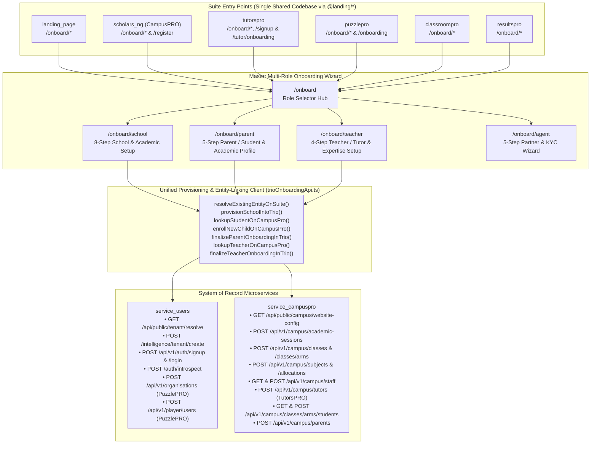

# Unified Suite Onboarding Architecture (`CampusPRO` + `ClassroomPRO` + `ResultsPRO` + `TutorsPRO` + `PuzzlePRO`)

## 1. Executive Summary & Core Principle

Across the ResultsPRO Suite, **CampusPRO (`service_campuspro`)** and **Identity (`service_users`)** serve as the authoritative System of Record for:
- **Organizations, Schools & Tenants** (`public.tenants` and `puzzle_organisations` in `service_users`, mapped to `<slug>.scholars.ng` subdomains and custom domains)
- **User Identities & Role Memberships** (`public.users`, `public.user_tenant_roles`, and `puzzle_users` in `service_users`)
- **Academic Structure, Rosters & Tutoring Profiles** (`campus_academic_sessions`, `campus_academic_terms`, `campus_classes`, `campus_class_arms`, `campus_subjects`, `campus_subject_teachers`, `campus_class_subjects`, `campus_staff`, `campus_tutors`, `campus_class_students`, and `campus_parents` / `campus_parent_wards` in `service_campuspro`)

Because **ClassroomPRO (`classroompro`)**, **ResultsPRO (`resultspro`)**, **TutorsPRO (`tutorspro`)**, and **PuzzlePRO (`puzzlepro`)** share a single identity token and derive their academic context from `service_campuspro` and `service_users`:
1. **A school, teacher/tutor, parent/student, or partner is onboarded through one single unified wizard.**
2. **Regardless of which application the user enters from** (`landing_page`, `scholars_ng`, `tutorspro`, `puzzlepro`, `classroompro`, or `resultspro`), **they use the exact same onboarding codebase** (`@landing/app/(marketing)/onboard/*` + `landing_page/src/lib/trioOnboardingApi.ts`).
3. **Every user role provides the complete academic background required by all 5 applications** during onboarding, and **can link directly to an already-existing entity** (an existing school tenant, an existing enrolled student record, or an existing pre-registered staff/tutor record).

---

## 2. High-Level Suite Onboarding & Entity-Linking Data Flow

---

## 3. Single-Codebase Monorepo Mounting Across All Apps

Every frontend application in the monorepo maps `"@landing/*"` in its `tsconfig.json` to `landing_page/src/*` and re-exports the shared onboarding wizard pages:

| Application | `tsconfig.json` Alias | Mounted Onboarding Routes |
| :--- | :--- | :--- |
| **`landing_page`** (Central Suite Hub) | Canonical source (`src/app/(marketing)/onboard/*`) | `/onboard`, `/onboard/school`, `/onboard/parent`, `/onboard/teacher`, `/onboard/agent` |
| **`scholars_ng`** (`CampusPRO`) | `"@landing/*": ["../../landing_page/src/*"]` | `/onboard`, `/register`, `/onboard/school`, `/onboard/parent`, `/onboard/teacher`, `/onboard/agent` |
| **`tutorspro`** (`TutorsPRO`) | `"@landing/*": ["../landing_page/src/*"]` | `/onboard`, `/signup`, `/tutor/onboarding` (mounts `/onboard/teacher`), `/onboard/school`, `/onboard/parent`, `/onboard/teacher`, `/onboard/agent` |
| **`puzzlepro`** (`PuzzlePRO`) | `"@landing/*": ["../landing_page/src/*"]` | `/onboard`, `/onboarding`, `/onboard/school`, `/onboard/parent`, `/onboard/teacher`, `/onboard/agent` |
| **`classroompro`** (`ClassroomPRO`) | `"@landing/*": ["../landing_page/src/*"]` | `/onboard`, `/onboard/school`, `/onboard/parent`, `/onboard/teacher`, `/onboard/agent` |
| **`resultspro`** (`ResultsPRO`) | `"@landing/*": ["../landing_page/src/*"]` | `/onboard`, `/onboard/school`, `/onboard/parent`, `/onboard/teacher`, `/onboard/agent` |

---

## 4. Academic Background & Entity Linking Collected Per User Role

To ensure that every user has the complete academic profile required across **CampusPRO**, **ClassroomPRO**, **ResultsPRO**, **TutorsPRO**, and **PuzzlePRO** immediately after onboarding, each role flow collects both **Entity Links** and **Suite-Wide Academic Background**:

### 4.1 School Admin (`/onboard/school` — 8 Steps)
- **Entity Linking (Step 1)**:
  - School Admins can either **Link to an Existing School Entity** by entering an existing school code / subdomain slug (`resolveExistingEntityOnSuite(existingTenantSlug)` → pre-fills school name, motto, brand colors, and curriculum) **or** provision a brand-new school tenant.
- **Academic Background Collected**:
  1. **Curriculum Standard** (`NERDC / WAEC Standard`, `IGCSE / British Curriculum`, `Hybrid Nigerian-British`, `American / Common Core`) — powers `ResultsPRO` grading schemas and `ClassroomPRO` syllabus alignment.
  2. **PuzzlePRO Coding & STEM Track** (`World 1–6 Full Future Skills Track`, `Primary Algorithmic & Block Coding`, `Junior Secondary Python & Web`, `Senior Secondary AI & Software Studio`) — registers the school organisation in `service_users` (`POST /api/v1/organisations`) for `PuzzlePRO` coding cohorts.
  3. **Academic Session & 3 Terms** (`POST /api/v1/campus/academic-sessions` on `service_campuspro`).
  4. **Classes & Class Arms/Sections** (`POST /api/v1/campus/classes` & `POST /api/v1/campus/classes/arms`).
  5. **Curriculum Subjects & Arm Allocations** (`POST /api/v1/campus/subjects` & `POST /api/v1/campus/subjects/allocations`).
  6. **Teachers & Subject Allocations** (`POST /api/v1/campus/staff` & `POST /api/v1/campus/subjects/allocations`).
  7. **Initial Student Roster** (`POST /api/v1/campus/classes/arms/students`).
  8. **Enabled Suite Modules**: `["campuspro", "classroompro", "resultspro", "tutorspro", "puzzlepro"]`.

### 4.2 Parent / Student (`/onboard/parent` — 5 Steps)
- **Entity Linking (Step 3 & Step 4)**:
  1. **Link to Existing School Entity**: Parents/students can enter an existing school code or subdomain (e.g., `greenwoodhigh`) and click **Link School Entity** (`resolveExistingEntityOnSuite`), scoping student lookups and enrollments to that school tenant, or leave it blank to onboard as an independent learner on `TutorsPRO` / `PuzzlePRO`.
  2. **Link to Existing Enrolled Student(s) & Siblings**: Queries `lookupStudentOnCampusPro(admissionNumber, tenantId)` (`GET /api/v1/campus/classes/arms/students?search=...`) to link existing enrolled students by official Admission Number, or enrolls a new child via `enrollNewChildOnCampusPro()`.
- **Academic Background Collected**:
  1. **Class / Grade Level** (e.g., `JSS 2`, `Grade 10A`) — links the learner to the right class cohort in `CampusPRO` and `ResultsPRO`.
  2. **Curriculum Standard** (`NERDC / WAEC Standard`, `IGCSE / British Curriculum`, `American / Common Core`, `Montessori / Early Years`).
  3. **Focus Subjects** (`Mathematics`, `English Language`, `Physics`, `Chemistry`, `Biology`, `Further Maths`, `Computer Science`, `Economics`) — used by `ClassroomPRO` Study Pack recommendations and `TutorsPRO` tutor matching.
  4. **PuzzlePRO Coding & Future Skills World** (`World 1: Algorithmic Foundations` through `World 6: Capstone Software Studio`) — automatically provisions the learner's coding player profile via `POST /api/v1/player/users`.

### 4.3 Teacher / Tutor (`/onboard/teacher` & `/tutor/onboarding` — 4 Steps)
- **Educator Mode & Entity Linking (Step 2)**:
  - Supports three operating modes across the suite:
    1. **School Teacher (`SCHOOL_STAFF`)** — links to an existing school tenant via school code/slug (`resolveExistingEntityOnSuite`) and pre-fills pre-registered staff details from `service_campuspro` (`lookupTeacherOnCampusPro`).
    2. **1-on-1 Tutor (`INDEPENDENT_TUTOR`)** — onboards as an independent marketplace educator on `TutorsPRO`.
    3. **Both School Teacher & TutorsPRO Educator (`BOTH`)** — links to an existing school entity AND activates a 1-on-1 tutoring profile on `TutorsPRO`.
- **Academic Background & Teaching Profile Collected (Step 3 & Step 4)**:
  1. **Academic Specialization Degree** (e.g., `B.Sc. Mathematics`, `M.Sc. Physics`, `B.Sc. Computer Science & Robotics`).
  2. **Experience Level / Certification** (`Certified Teacher (TRCN / PGDE)`, `Masters / PhD Educator`, `Graduate Educator`, `Undergraduate Tutor`).
  3. **Subject Expertise Tags** (`Mathematics`, `Physics`, `Chemistry`, `Biology`, `English Language`, `Further Maths`, `Economics`, `Coding & Robotics (PuzzlePRO)`) — powers `ClassroomPRO` lesson note generation, `ResultsPRO` subject gradebooks, and `TutorsPRO` subject discovery.
  4. **TutorsPRO 1-on-1 Hourly Rate (₦)** and **Professional Teaching Bio**.
  5. **Class & Subject Assignment Verification** (with live discrepancy reporting to the school administrator).
- **Downstream Persistence (`finalizeTeacherOnboardingInTrio`)**:
  - Creates the unified identity in `service_users` (`POST /api/v1/auth/signup`).
  - Persists/updates the staff record in `service_campuspro` (`POST /api/v1/campus/staff`).
  - Persists the tutoring profile in `service_campuspro` (`POST /api/v1/campus/tutors`) and `service_tutorspro` (`POST /api/v1/tutor/onboarding`).

### 4.4 Agent / Partner (`/onboard/agent` — 5 Steps)
- Collects partner registration bio-data, Nigerian State/LGA coverage territory, KYC identity document verification, commercial bank payout ledger details, and custom referral slug (`resultspro.ng/ref/<slug>`) which links directly to schools onboarded with a referral code.

---

## 5. Unified Identity & Tenant Resolution Across Subdomains and Central URLs

Users can authenticate from either:
1. **A school's tenant-isolated subdomain on `scholars_ng`** (e.g., `greenwoodhigh.scholars.ng`), where the tenant is known from the hostname before login, **or**
2. **A central application URL** (e.g., `resultspro.ng`, `classroompro.resultspro.ng`, `tutorspro.resultspro.ng`, or `puzzlepro.resultspro.ng`), where the URL hostname is the app's own domain rather than a school subdomain.

To ensure seamless tenant isolation in both access modes:
1. **`service_users/handlers/auth.go` (`HandleLogin` & `HandleIntrospect`)**:
   - `HandleLogin` queries `user_tenant_roles` and embeds `"tenants"` (`slug -> { id, role }`), `"tenant_id"`, and `"tenant_slug"` inside both the signed JWT claims and the login JSON response (`res.data.tenant_id` and `res.data.user.tenant_id`).
   - When `HandleIntrospect` (`POST /auth/introspect`) is called from a central app domain (or with an empty `domain`), it automatically resolves `tenant_id` from the user's active `user_tenant_roles` record or JWT claims rather than failing with `tenant_not_found`.
2. **Backend Auth Middlewares (`service_classroompro/middleware/auth.go` & `service_resultspro/middleware/auth.go`)**:
   - Ignore central app hostnames (`resultspro.ng`, `classroompro.resultspro.ng`, `localhost`, `*.onrender.com`) when inspecting `X-Tenant-Domain`.
   - Resolve `tenant_id` from `/auth/introspect`, explicit `X-Tenant-ID` headers, or directly from the Bearer JWT's `tenant_id` / `tenants` claims (`extractJWTClaims`).
3. **Frontend API Interceptors & Session Persistence (`persistTenantSession` in `trioOnboardingApi.ts`)**:
   - During onboarding or login, `tenantId` (`x-tenant-id`, `tenant_id`, `schoolId`, `tenant_slug`, `schoolName`) is persisted to `localStorage` and attached as `X-Tenant-ID` on every request across the entire ResultsPRO Suite.
